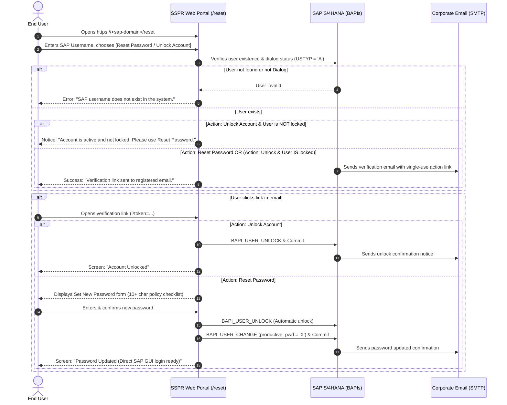

# SAP Self-Service Password Reset (SSPR) & Account Unlock Guide

This document describes the architecture, configuration, deployment, and operational procedures for the native **SAP Self-Service Password Reset & Account Unlock Portal** running on SAP S/4HANA and SAP NetWeaver.

---

## 1. Architecture & Solution Components

| Component | Technical Name | Object Type | Description |
| :--- | :--- | :--- | :--- |
| **Token Table** | `ZSSPR_TOKENS` | Transparent Table (DDIC) | Stores single-use SHA-256 hashed security tokens (`CHAR(64)`), request status (`PENDING`, `USED`, `EXPIRED`), client IP address, and validity timestamps. |
| **HTTP Handler** | `ZCL_SSPR_HTTP_HANDLER` | ABAP Class (`IF_HTTP_EXTENSION`) | Handles HTTP routing, serves minimalist HTML5/CSS interface, looks up user email, verifies lock status, executes `BAPI_USER_CHANGE` & `BAPI_USER_UNLOCK`, and sends emails via `CL_BCS`. |
| **Admin Cockpit** | `Z_USER_03_SSPR_ADMIN` | ABAP Report (SE38) | Centralized administration tool for SAP Basis/Security to monitor token requests, inspect client IPs, jump directly to SU01, and clean up expired tokens. |
| **ICF Service** | `/sap/bc/z_sspr` | SICF Node | Inbound HTTP/HTTPS endpoint on SAP Internet Communication Manager (ICM). |
| **External Alias** | `/reset` | SICF External Alias | User-friendly short URL alias mapped directly to `/sap/bc/z_sspr`. |

---

## 2. Key Business Rules & Security Logic

1. **Strict User Existence & Validity Verification**:
   - The portal strictly checks whether the entered username exists in SAP (`USR02` & `BAPI_USER_GET_DETAIL`), is an active dialog user (`USTYP = 'A'`), and is within its validity period (`GLTGV` .. `GLTGB`).
   - Protected system accounts (`SAP*`, `DDIC`, `TMSADM`, `EARLYWATCH`, `SAPCPIC`) and accounts in groups `SUPER` / `ADMIN` are strictly blocked at all lifecycle stages.
2. **Smart Unlock Verification & Administrator Lock Protection**:
   - Self-service unlock is permitted **only** for wrong-logon locks (`WRNG_LOGON`, `UFLAG = 128`).
   - Accounts locked by an administrator (`LOCAL_LOCK`, `GLOB_LOCK`, `UFLAG` bits `32` or `64`) are blocked from self-service unlock and password reset, and users are instructed to contact the IT Service Desk.
   - Clicking an unlock link displays a confirmation button (`POST` request) so email security scanners (e.g., Microsoft Defender Safe Links) cannot prematurely trigger unlocks via `GET`.
3. **Automatic Unlock on Password Reset**:
   - When a user resets their password, the system calls **`BAPI_USER_UNLOCK`** only **after** **`BAPI_USER_CHANGE`** has succeeded. If password validation fails, `BAPI_TRANSACTION_ROLLBACK` is executed so the account lock state is never altered on a failed attempt.
4. **Environment-Aware Password State (Production vs. Non-Production)**:
   - **Production Systems (`sy-sysid CS 'P'`)**: Strictly adheres to SAP standard BAPI lifecycle (`BAPI_USER_CHANGE`) with zero direct database modifications on `USR02`, preserving full SAP Change Document audit trails. The user is informed on screen and by email that SAP will prompt them to change the initial password one more time upon first logon.
   - **Non-Production Systems (Dev/Test/Sandbox where `sy-sysid` does not contain `'P'`)**: Automatically sets productive password flags (`PWDINITIAL = 2`, `PWDSTATE = 0`, `BCDA1 = 00000000`, `LTIME = sy-uzeit`) for testing convenience.
5. **Cryptographic Token Security (CSPRNG + SHA-256 Hashing)**:
   - Tokens are generated using SAP's cryptographic random generator (`GENERATE_SEC_RANDOM`, 32 bytes / 256 bits) and stored in `ZSSPR_TOKENS` exclusively as **SHA-256 hashes** (`CL_ABAP_MESSAGE_DIGEST`).
   - Token expiration (15 minutes) and attempt limits (max 5 failed attempts) are enforced identically on both `GET` and `POST` requests, with atomic database claiming (`WHERE status = 'PENDING'`) to prevent race conditions.
5. **Password Complexity Policy**:
   - Minimum length: **10 characters**.
   - Requires at least:
     - 1 uppercase letter (`A-Z`)
     - 1 lowercase letter (`a-z`)
     - 1 numeric digit (`0-9`)
     - 1 special character (e.g. `@`, `#`, `$`, `!`, `%`, `*`)
   - Real-time client-side validation checklist and server-side ABAP enforcement.
6. **Concise User Interface**:
   - All notifications, alerts, and instructions are minimal and clear without displaying unnecessary internal system details.
7. **Client Binding & Transparent Display**:
   - Each ICF service node or external alias is securely bound to the Client configured in its SICF Logon Data.
   - The portal automatically retrieves the active client (`sy-mandt`) and its description from table `T000` (e.g., `110 - Test` or `100 - Config. + ABAP`) and displays it clearly on the landing page as a read-only field.
   - The password reset screen reinforces this context: `Account: <username> • Client: <mandt>`.
   - For multi-client environments, separate external aliases can be mapped (e.g., `/reset` for Client 110, `/reset100` for Client 100).

---

## 3. SICF Web Service Configuration

To allow users who forgot their passwords or are locked out to access the self-service web page, the ICF service node must be configured with a dedicated background service user.

### Step 1: Open Transaction `SICF`
1. Log in to SAP GUI with Basis administration privileges.
2. Enter transaction code `/nSICF` and press Enter.
3. Click **Execute (F8)** to display the Virtual Hosts / Service hierarchy.

### Step 2: Create the Service Node
1. Expand the tree path:  
   `default_host` $\longrightarrow$ `sap` $\longrightarrow$ `bc`
2. Right-click on **`bc`** $\longrightarrow$ Select **New Sub-Element**.
3. Enter service details:
   - **Service Name**: `z_sspr` (lowercase)
   - **Description**: `SAP Self-Service Password Reset & Unlock Portal`
4. Confirm with **Enter**.

### Step 3: Assign Handler Class
1. Go to the **Handler List** tab.
2. On row `1`, enter:
   ```text
   ZCL_SSPR_HTTP_HANDLER
   ```

### Step 4: Configure Logon Data (Critical Step)
> [!IMPORTANT]
> Under the **Logon Data** tab, ensure the following settings:
> - **Procedure**: Set to **`Standard`** (or **`Required with Logon Data`**).  
>   *(Do **NOT** set to `Required with SSL Certificate` because that requires client X.509 certificate authentication and blocks normal browser access).*
> - **Client**: Enter your active client (e.g. `110`).
> - **User**: Enter a dedicated Service User (e.g. `SSPR_SVC`).
> - **Password**: Enter the password for the service user.
> 
> When `Procedure` is `Standard` and service user credentials are saved in Logon Data, the browser will open the self-service portal immediately without prompting the user for credentials.

#### Minimum Authorizations for `SSPR_SVC` (SU01):
- **User Type**: `B` (System User) or `S` (Service User).
- **Authorizations**:
  - **`S_USER_GRP`**: `CLASS = *`, `ACTVT = 02, 03, 05, PP`
    > [!IMPORTANT]
    > **Activity `PP` (*Passwort pflegen* / Maintain Password)** is **mandatory**. `BAPI_USER_CHANGE` explicitly checks `S_USER_GRP` with `ACTVT = PP` when changing or resetting user passwords. If `PP` is omitted, the BAPI fails with authorization error `01 497` (*"No authorization to change the password of user &"*).
    > - `02`: Change user master
    > - `03`: Display user master
    > - `05`: Lock / unlock user
    > - `PP`: Maintain password
  - **`S_USER_VAL`**: `FIELD = *` (Allows setting password values).
  - **`S_OC_SEND`**: Permission to dispatch emails via Business Communication Services (`CL_BCS`).
  - *Never assign `SAP_ALL` or broad administrator profiles to `SSPR_SVC`.*

### Step 5: Activate and Test the Service
1. Save (**Ctrl + S**) and assign to your Transport Request (or local object `$TMP`).
2. Right-click on node `z_sspr` $\longrightarrow$ Select **Activate Service** (choose Yes).
3. Right-click on node `z_sspr` $\longrightarrow$ Select **Test Service**.
4. The browser opens:
   ```text
   https://<sap-host>:<port>/sap/bc/z_sspr
   ```

---

## 4. Short URL Configuration via External Alias (`/reset`)

The standard ICF URL path (`/sap/bc/z_sspr`) is long and difficult for end users to remember. SAP ICF supports **External Aliases**, allowing any short top-level URL path to map directly to the target ICF service.

### Alias Name Evaluation & Recommendation

| Short Alias | Length | Memorability | Scope Coverage | Recommendation |
| :--- | :---: | :--- | :--- | :--- |
| **`/reset`** | **5 chars** | **Highest** | Covers both Password Reset and Account Unlock | ⭐ **Strongly Recommended** |
| `/pwd` | 3 chars | High | Primarily implies password, less intuitive for unlock | Good alternative (shortest) |
| `/pass` | 4 chars | Medium | Implies password only | Alternative |
| `/sspr` | 4 chars | Medium | Technical IT acronym, less obvious to business users | Technical choice |
| `/selfservice`| 12 chars | Medium | Longer to type | Too verbose |

> **Selection**: **`/reset`** is the cleanest, most professional, and intuitive link for end users (`https://<sap-domain>/reset`).

---

### Step-by-Step: Creating the External Alias in `SICF`

1. Open transaction **`SICF`**.
2. Click the **External Aliases** button on the application toolbar (or press `Shift + F6`).
3. In the tree display, select the root host:
   ```text
   default_host
   ```
4. Click the **Create External Alias** button (or press `F5` / click the white paper icon).
5. In the **External Alias** screen, fill in:
   - **External Alias**: `/reset` (must begin with a forward slash `/`).
   - **Description**: `SAP Self-Service Password Reset & Unlock Alias`.
6. Go to the **Trg Element** (Target Element) tab:
   - Expand the tree hierarchy:  
     `default_host` $\longrightarrow$ `sap` $\longrightarrow$ `bc`
   - Locate and **double-click** the service **`z_sspr`**.
   - The Target Element field at the top will now display:
     ```text
     /default_host/sap/bc/z_sspr
     ```
7. Go to the **Logon Data** tab:
   - Ensure logon data is inherited from the target element or set to **Standard**.
8. Click **Save (Ctrl + S)** and assign to your Transport Request (or local object `$TMP`).
9. In the External Aliases tree, right-click `/reset` $\longrightarrow$ choose **Activate Service**.
10. **Verify the short URL**:
    Open any web browser and navigate to:
    ```text
    https://<your-sap-domain>/reset
    ```
    The portal will render immediately without path redirection delays.

---

## 5. End-User Workflow



---

## 6. Administration & Audit Cockpit (`Z_USER_03_SSPR_ADMIN`)

Run report **`Z_USER_03_SSPR_ADMIN`** in transaction `SE38` or `SA38`:

1. **Flexible Filters**:
   - Filter by `Created Date` range.
   - Filter by `SAP Username`.
   - Filter by `Action Type` (`RESET_PWD`, `UNLOCK`, or All).
   - Filter by `Token Status` (`PENDING`, `USED`, `EXPIRED`, or All).
2. **ALV Cockpit Indicators**:
   - Status LEDs:
     - 🟢 **`@08@ [USED]`**: Action completed successfully.
     - 🟡 **`@09@ [PENDING]`**: Waiting for user verification.
     - 🔴 **`@0A@ [EXPIRED]`**: 15-minute validity window elapsed without activation.
   - **Hotspot SU01**: Click on any Username to open transaction `SU01` for direct inspection.
   - **Hotspot Token ID**: Click to inspect the full UUID token string and originating client IP address.
3. **Automated Token Maintenance**:
   - Check **Cleanup Expired Tokens** and specify the retention period in days (default: 7 days). The report safely purges expired or used tokens from table `ZSSPR_TOKENS`.

---

## 7. Security & Compliance Architecture

- **Standard SAP BAPIs**: User modifications and unlocks are performed through certified standard APIs (`BAPI_USER_CHANGE`, `BAPI_USER_UNLOCK`, `BAPI_USER_GET_DETAIL`).
- **Productive Password Flags**: BAPI `productive_pwd = 'X'` combined with productive USR02 state updates (`PWDINITIAL = 2`, `PWDSTATE = 0 / 255`, `BCDA1 = 00000000`, `LTIME = sy-uzeit`) ensures direct SAP GUI access without prompt to change password.
- **Single-Use Replay Protection**: Each UUID token can only be consumed once. Upon successful completion, its status transitions immediately to `USED`.
- **Short Expiration Window**: Tokens have a strict 15-minute Time-To-Live (TTL).
- **Administrative Account Protection**: Self-service actions are hard-blocked for critical system accounts (`SAP*`, `DDIC`, `TMSADM`, etc.) and users assigned to administrative user groups (`SUPER`, `ADMIN`).
- **Clean Audit Trail**: Client requests and token activations are recorded in `ZSSPR_TOKENS` with IP, dates, and timestamps for Basis audit reporting. User emails omit IP addresses to avoid confusion when accessed behind enterprise reverse proxies.
