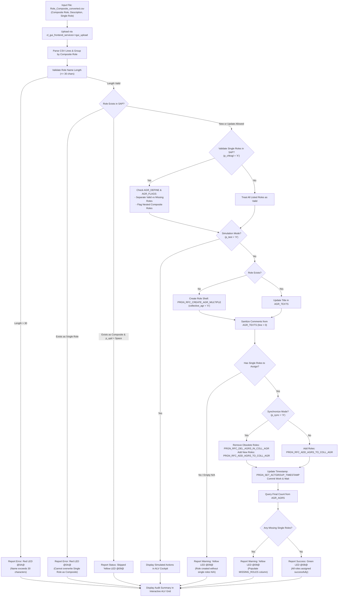

# 📦 Z_AUTH_ROLE_COMPOSITE: Batch Composite Role Creation & Single Role Assignment

> **SAP Basis Utilities & AI-Assisted ABAP Development via Model Context Protocol (MCP)**  
> **Source Code**: [`src/z_auth_role_composite.prog.abap`](../src/z_auth_role_composite.prog.abap)  
> **Companion Script**: [`scripts/convert_role_composite_excel.py`](../scripts/convert_role_composite_excel.py)  
> **Conversion Guide**: [`docs/ROLE_CONVERSION_GUIDE.md`](ROLE_CONVERSION_GUIDE.md)  
> **Repository**: [https://github.com/luongdk18/SAPABAP](https://github.com/luongdk18/SAPABAP)

The ABAP utility **`Z_AUTH_ROLE_COMPOSITE`** is an operational tool designed for SAP Security Administrators and Authorization Architects. It automates the mass creation and updating of **Composite Roles** (Collective Roles / *Sammelrollen*) and bundles member **Single Roles** (or Derived Single Roles) directly from flat CSV data.

The program creates the composite role shell (`AGR_DEFINE-ATTRIBUTES = 'COLLECTIVE'`, `AGR_FLAGS-COLL_AGR = 'X'`), preserves custom business descriptions while stripping intrusive auto-generated SAP comment lines, validates member single roles against the SAP repository, assigns member roles atomically via standard PFCG BAPIs (`PRGN_RFC_ADD_AGRS_TO_COLL_AGR`), handles role synchronization, and reports execution details in an interactive ALV cockpit with direct navigation to transaction `PFCG`.

---

## 📌 Table of Contents
1. [Business Context & Problem Statement](#1-business-context--problem-statement)
2. [End-to-End Processing Workflow](#2-end-to-end-processing-workflow)
3. [Key Architectural & Functional Features](#3-key-architectural--functional-features)
   - [3.1. Native Composite Role Definition (`COLL_AGR = 'X'`)](#31-native-composite-role-definition-coll_agr--x)
   - [3.2. Preserving Exact Spacing in Role Titles & Stripping PFCG Comments](#32-preserving-exact-spacing-in-role-titles--stripping-pfcg-comments)
   - [3.3. Member Single Role Validation & Non-Blocking Isolation](#33-member-single-role-validation--non-blocking-isolation)
   - [3.4. Warning Status (`@09@`) for Empty Composite Roles (`N/A`)](#34-warning-status-09-for-empty-composite-roles-na)
   - [3.5. Atomic Assignment via BAPI & Synchronization (`p_sync`)](#35-atomic-assignment-via-bapi--synchronization-p_sync)
   - [3.6. Restriction Enforcement: Preventing Nested Composite Roles](#36-restriction-enforcement-preventing-nested-composite-roles)
   - [3.7. Interactive ALV Cockpit with Direct PFCG Navigation](#37-interactive-alv-cockpit-with-direct-pfcg-navigation)
4. [Selection Screen & Operational Options](#4-selection-screen--operational-options)
5. [Standard SAP Function Modules & Database Tables](#5-standard-sap-function-modules--database-tables)
6. [Operational Step-by-Step Guide](#6-operational-step-by-step-guide)
7. [Troubleshooting & Frequently Asked Questions (FAQ)](#7-troubleshooting--frequently-asked-questions-faq)

---

## 1. Business Context & Problem Statement

In enterprise SAP security frameworks, **Composite Roles** represent user job descriptions or organizational positions (e.g. `Chief Financial Officer - Entity 1000`, `General Accountant - Entity 2000`). Rather than assigning dozens of individual single roles to end users in transaction `SU01`, security administrators bundle those single roles into composite roles. When the composite role is assigned to a user, SAP user comparison automatically provisions all underlying single roles to the user's master record.

### Operational Bottlenecks in Standard PFCG:
1. **Repetitive Manual Role Assembly**: Creating 50 composite job roles and manually typing or searching for 10–20 single roles in the "Roles" tab of transaction `PFCG` requires hundreds of manual operations and takes hours.
2. **Missing Role Failures**: In manual entry, mistyping a single role or referencing a role that has not yet been derived causes confusion and incomplete access assignments.
3. **Overwriting Protection**: Accidentally creating a composite role with the same name as an existing single role can corrupt authorization profiles or role flags.
4. **No Mass Synchronization Cockpit**: When business job matrices change, adjusting member roles across dozens of composite roles manually leads to role assignment discrepancies.

`Z_AUTH_ROLE_COMPOSITE` automates this entire lifecycle, converting matrix CSV definitions into verified, synchronized composite roles in seconds.

---

## 2. End-to-End Processing Workflow



---

## 3. Key Architectural & Functional Features

### 3.1. Native Composite Role Definition (`COLL_AGR = 'X'`)
* Calls standard SAP function module `PRGN_RFC_CREATE_AGR_MULTIPLE` with parameter `collective_agr = 'X'`.
* Standard tables are natively initialized:
  * `AGR_DEFINE-ATTRIBUTES = 'COLLECTIVE'`.
  * `AGR_FLAGS-FLAG_TYPE = 'COLL_AGR'` and `FLAG_VALUE = 'X'`.
* Ensures the role has no authorization profile requirements (`AGR_1250`/`AGR_1251`/`AGR_1252`), matching SAP architectural standards for collective roles.

### 3.2. Preserving Exact Spacing in Role Titles & Stripping PFCG Comments
* Preserves original title capitalization and spacing from CSV column 2 directly into `AGR_TEXTS`.
* Standard creation modules automatically insert boilerplate comment lines (`"The role was created automatically and can be processed manually."`). The program sanitizes these lines (`DELETE FROM agr_texts WHERE agr_name = ... AND line > '00000'`), keeping PFCG role catalogs clean.

### 3.3. Member Single Role Validation & Non-Blocking Isolation
When **Validate Single Roles in SAP** is active (`p_chksgl = 'X'`):
* Every single role assigned to a composite role is checked in bulk against table `AGR_DEFINE`.
* Roles not found in the SAP system are collected into a dedicated column: **`MISSING_ROLES`**.
* **Non-Blocking Execution**: Missing single roles do **not** abort role creation. Valid single roles are still assigned, and the composite role status is set to **Warning (Yellow LED `@09@`)**, allowing administrators to review and import missing roles later.

### 3.4. Warning Status (`@09@`) for Empty Composite Roles (`N/A`)
If a composite role column in the source matrix has no single roles assigned (indicated by `N/A`, `-`, or blank in column 3):
* The composite role shell is successfully created in `AGR_DEFINE`.
* The status is reported as **Warning (Yellow LED `@09@`)** with message:
  ```text
  Composite role created without single roles (N/A).
  ```

### 3.5. Atomic Assignment via BAPI & Synchronization (`p_sync`)
* Single roles are assigned in bulk using standard SAP BAPI `PRGN_RFC_ADD_AGRS_TO_COLL_AGR` (`profile_comparison = 'X'`).
* When **Synchronize Single Roles** (`p_sync = 'X'`) is checked:
  * Existing assignments in table `AGR_AGRS` are inspected.
  * Any single role present in SAP but no longer listed in the CSV is removed via `PRGN_RFC_DEL_AGRS_IN_COLL_AGR`.
  * New single roles are added.
  * This guarantees that composite role memberships exactly match the uploaded business matrix.

### 3.6. Restriction Enforcement: Preventing Nested Composite Roles
SAP standard authorization architecture forbids nesting a composite role inside another composite role. 
* The program validates each member role against `AGR_FLAGS` (`COLL_AGR = 'X'`).
* If an administrator inadvertently lists a composite role in column 3, the program rejects it from the assignment list, reports it in `MISSING_ROLES`, and issues a warning.

### 3.7. Interactive ALV Cockpit with Direct PFCG Navigation
The output ALV grid (`CL_SALV_TABLE`) provides full auditing transparency:
* **Status Icons**: `@08@` (Green LED - Success), `@09@` (Yellow LED - Warning / Skipped), `@0A@` (Red LED - Error).
* **Metrics**:
  * `ROLES_CNT`: Total single roles listed in CSV for this composite role.
  * `VALID_CNT`: Single roles validated to exist in SAP.
  * `ASSIGNED_CNT`: Roles successfully assigned in `AGR_AGRS`.
  * `MISSING_ROLES`: List of missing single role IDs.
* **Interactive Hotspot**: Clicking on any Composite Role Name directly opens transaction `PFCG` to inspect the role's "Roles" tab.

---

## 4. Selection Screen & Operational Options

```text
╔══════════════════════════════════════════════════════════════════════════╗
║ Selection Screen: Z_AUTH_ROLE_COMPOSITE                                  ║
╠══════════════════════════════════════════════════════════════════════════╣
║ [Input CSV File (.csv)]                                                  ║
║   File Path:             [ D:\PROJECTS\SAPABAP\excel-templates\... ] 📁 ║
║                                                                          ║
║ [Execution & Assignment Options]                                         ║
║   [X] Simulation (Test Run)                                              ║
║   [X] Update Existing Composite Roles                                    ║
║   [X] Synchronize Single Roles                                           ║
║   [X] Validate Single Roles in SAP                                       ║
╚══════════════════════════════════════════════════════════════════════════╝
```

| Parameter | Technical Name | Default | Description |
| :--- | :--- | :--- | :--- |
| **File Path** | `p_file` | *Empty* | Path to the 3-column CSV file (`Composite Role`, `Description`, `Single Role`). |
| **Simulation (Test Run)** | `p_test` | `'X'` | Validates role names, checks single role existence, and previews planned actions without writing to SAP database. |
| **Update Existing Composite Roles** | `p_upd` | `'X'` | If checked, updates descriptions and membership of existing composite roles. If unchecked, skips existing roles. |
| **Synchronize Single Roles** | `p_sync` | `'X'` | Removes unlisted single roles from existing composite roles to ensure exact alignment with CSV matrix. |
| **Validate Single Roles in SAP** | `p_chksgl` | `'X'` | Verifies that member roles exist in `AGR_DEFINE` and are not composite roles. Missing roles are listed in the ALV. |

---

## 5. Standard SAP Function Modules & Database Tables

### Function Modules
| Function Module | Purpose |
| :--- | :--- |
| `PRGN_RFC_CREATE_AGR_MULTIPLE` | Creates composite role shell with `collective_agr = 'X'` (`AGR_DEFINE`, `AGR_FLAGS`). |
| `PRGN_RFC_ADD_AGRS_TO_COLL_AGR` | Assigns single roles to composite role (`AGR_AGRS`) and triggers user/profile comparison. |
| `PRGN_RFC_DEL_AGRS_IN_COLL_AGR` | Removes single roles from composite role during synchronization. |
| `PRGN_SET_ACTGROUP_TIMESTAMP` | Updates role modification timestamp and user in `AGR_DEFINE`. |

### Database Tables
| Table | Description | Usage in Program |
| :--- | :--- | :--- |
| `AGR_DEFINE` | Role definitions | Creates role header, checks existence, sets `ATTRIBUTES = 'COLLECTIVE'`. |
| `AGR_FLAGS` | Role attributes | Maintains `COLL_AGR = 'X'` flag, verifies single roles are not composite roles. |
| `AGR_TEXTS` | Role titles & descriptions | Stores role description and strips automatic comment lines. |
| `AGR_AGRS` | Composite-to-Single role assignments | Stores member single role mappings (`CHILD_AGR`). |

---

## 6. Operational Step-by-Step Guide

### Step 1: Preprocess Matrix with Python Script
Prepare your composite role spreadsheet (e.g. `Template_Roles_Composite.xlsx` or working matrix in `excel-working/`) and run the preprocessor:
```bash
npm run convert:role:composite
# Output generated: excel-templates/Template_Roles_Composite_converted.csv
```

### Step 2: Launch `Z_AUTH_ROLE_COMPOSITE` in SAP
1. Open transaction **`SE38`** or **`SA38`**.
2. Enter program name: `Z_AUTH_ROLE_COMPOSITE` and click **Execute (F8)**.
3. Select the converted `.csv` file.
4. Keep **Simulation (Test Run)** checked (`p_test = 'X'`).
5. Execute (**F8**).

### Step 3: Review Planned Assignments in Simulation Cockpit
* Check the **Action** column:
  * `SIMULATE`: Roles that will be created or updated.
* Review `ROLES_CNT`, `VALID_CNT`, and `MISSING_ROLES`:
  * If any single roles are missing from SAP, they are listed in `MISSING_ROLES` with a Yellow LED (`@09@`).
* Click on any role name to navigate to `PFCG` if needed.

### Step 4: Execute Live Composite Role Creation
1. Return to the selection screen (**F3**).
2. Uncheck **Simulation (Test Run)** (`p_test = space`).
3. Ensure **Update Existing Composite Roles** and **Synchronize Single Roles** are checked.
4. Execute (**F8**).
5. All composite roles are created/updated and member single roles are assigned in `AGR_AGRS`.
6. Click any composite role in the ALV to open `PFCG` and inspect the populated "Roles" tab.

---

## 7. Troubleshooting & Frequently Asked Questions (FAQ)

### Q1: Why does the program report: *"Role '...' exists in SAP as a SINGLE role; cannot overwrite single role as composite role"*?
**Answer**: An existing role in SAP with that name was created as a Single Role (it lacks the `COLL_AGR = 'X'` flag). In SAP architecture, you cannot convert an existing single role with authorizations into a composite role without deleting it first. Rename your composite role or decommission the conflicting single role.

### Q2: Why are some single roles shown in the `MISSING_ROLES` column?
**Answer**: When parameter `p_chksgl = 'X'` is active, the program checks each single role in `AGR_DEFINE`. If the single role has not yet been imported or derived (e.g. via `Z_AUTH_ROLE_CREATE` or `Z_AUTH_ROLE_DERIVE`), it is flagged as missing. Once the single roles are created in SAP, simply rerun `Z_AUTH_ROLE_COMPOSITE` with `p_upd = 'X'` to assign them.

### Q3: Do composite roles need authorization profile generation?
**Answer**: No. Composite roles in SAP do **not** have authorization profiles of their own. Authorizations are inherited entirely from the assigned member single roles. When a composite role is assigned to a user in transaction `SU01`, SAP user master comparison assigns all member single roles and their corresponding profiles to the user.
