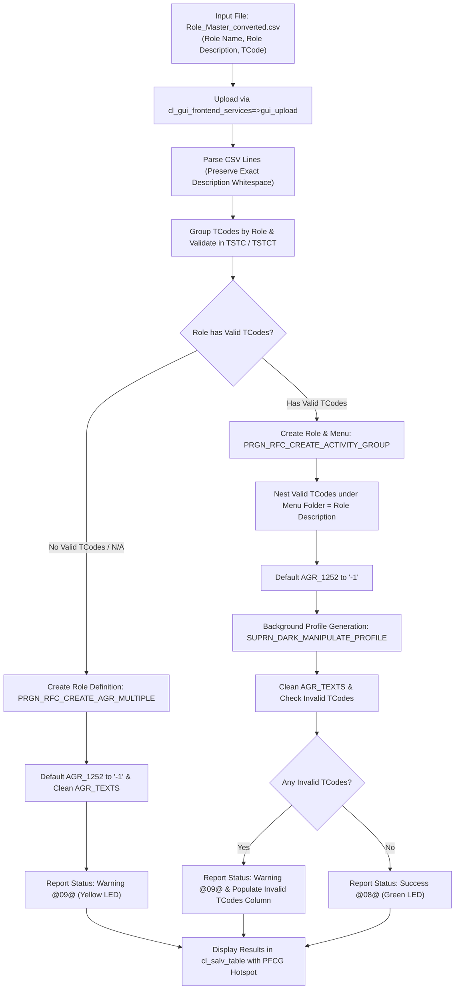

# 🏗️ Z_AUTH_ROLE_CREATE: Batch Master Single Role Creation & Menu Structuring

> **SAP Basis Utilities & AI-Assisted ABAP Development via Model Context Protocol (MCP)**  
> **Source Code**: [`src/z_auth_role_create.prog.abap`](../src/z_auth_role_create.prog.abap)  
> **Companion Script**: [`scripts/convert_role_master_excel.py`](../scripts/convert_role_master_excel.py)  
> **Repository**: [https://github.com/luongdk18/SAPABAP](https://github.com/luongdk18/SAPABAP)

The ABAP program **`Z_AUTH_ROLE_CREATE`** is an operational utility designed for SAP Security Administrators and Authorization Designers. It automates the mass creation and updating of **Master Single Roles** directly from flat CSV data, builds structured menu folder hierarchies, validates transaction codes against the SAP repository (`TSTC`), applies template-grade Organizational Level defaults (`-1`), cleans up unwanted automatic text comments, and compiles runtime authorization profiles in the background.

---

## 📌 Table of Contents
1. [Business Context & Problem Statement](#1-business-context--problem-statement)
2. [End-to-End Processing Workflow](#2-end-to-end-processing-workflow)
3. [Key Architectural & Functional Features](#3-key-architectural--functional-features)
   - [3.1. Preserving Exact Spacing & Formatting](#31-preserving-exact-spacing--formatting)
   - [3.2. Automatic Cleanup of Generic PFCG Comment Lines](#32-automatic-cleanup-of-generic-pfcg-comment-lines)
   - [3.3. Menu Folder Creation & Nesting](#33-menu-folder-creation--nesting)
   - [3.4. Non-Blocking TCode Validation (`TSTC`)](#34-non-blocking-tcode-validation-tstc)
   - [3.5. Warning Status (`@09@`) for Roles Without TCodes (`N/A`)](#35-warning-status-09-for-roles-without-tcodes-na)
   - [3.6. Master Role Organizational Level Architecture (`-1`)](#36-master-role-organizational-level-architecture--1)
   - [3.7. Idempotent Role Updates](#37-idempotent-role-updates)
4. [Selection Screen & Options](#4-selection-screen--options)
5. [Standard SAP Function Modules & Tables](#5-standard-sap-function-modules--tables)
6. [Operational Step-by-Step Guide](#6-operational-step-by-step-guide)

---

## 1. Business Context & Problem Statement

In large enterprise SAP implementations (S/4HANA or ECC), authorization design typically involves defining tens or hundreds of **Master Roles** (Template Single Roles) based on functional role matrices. 

### Operational Challenges in Standard PFCG:
1. **Manual Menu Construction is Painstaking**: Creating a folder in transaction `PFCG` and adding dozens of TCodes manually takes 10–15 minutes per role.
2. **Space Truncation**: Standard batch tools often execute `CONDENSE` on descriptions, destroying formatting such as `GL Master Data Maint.` or specific organizational spacing.
3. **Invalid TCodes Block Role Creation**: If a business matrix lists a decommissioned or custom TCode that has not yet been transported into `TSTC`, standard BAPIs fail and abort creation of the entire role.
4. **Dangerous Wildcard Org Defaults**: Standard SAP generation often sets unmaintained Organizational Levels to `'*'` (full authorization). For a Master Role intended as a template for subsequent derived roles, assigning `'*'` leaks broad company-wide access.
5. **No Visual Auditing Cockpit**: Standard imports lack an interactive status review with direct navigation to inspect results in `PFCG`.

---

## 2. End-to-End Processing Workflow



---

## 3. Key Architectural & Functional Features

### 3.1. Preserving Exact Spacing & Formatting
When reading role descriptions from CSV (column 2), `Z_AUTH_ROLE_CREATE` preserves original whitespace and punctuation without running destructive `CONDENSE` or trimming. The exact casing and spacing are replicated in the role title (`AGR_TEXTS`) and the menu folder title.

### 3.2. Automatic Cleanup of Generic PFCG Comment Lines
When SAP standard function modules create roles, they automatically append the English/German system comment:
> *"The role was created automatically and can be processed manually."*

`Z_AUTH_ROLE_CREATE` automatically deletes these secondary comment lines (`DELETE FROM agr_texts WHERE agr_name = ... AND line > '00000'`), keeping `PFCG` documentation neat and professional.

### 3.3. Menu Folder Creation & Nesting
For every master role with valid transaction codes, the program builds a 2-level hierarchy in `SMENSAPNEW`:
* **Level 1 (Folder)**: Named identically to the Role Description (`MENU_LEVEL = 1`, `REPORTTYPE = space`).
* **Level 2 (Transactions)**: All assigned TCodes are parented strictly under Level 1 (`PARENT_ID = '00001'`, `REPORTTYPE = 'TR'`).

### 3.4. Non-Blocking TCode Validation (`TSTC`)
When the option **Validate TCodes in TSTC** is checked (`p_chktc = 'X'`):
* All TCodes are verified in bulk against SAP table `TSTC`.
* **Non-Blocking Rule**: Invalid TCodes are isolated and excluded from menu generation so they do not abort the role creation process.
* **Dedicated Invalid TCodes Column**: All invalid TCodes are listed in a separate column (`INVALID_TCODES`) on the ALV grid, allowing administrators to report them back to the functional team.

### 3.5. Warning Status (`@09@`) for Roles Without TCodes (`N/A`)
If a role in the business matrix has no transactions assigned (marked as `N/A`, `-`, or blank), the role definition is successfully created in `AGR_DEFINE`, but the ALV status reflects a **Warning (Yellow LED `@09@`)** with message:
```text
Warning: Role created without TCodes (N/A); Org levels defaulted to '-1'.
```
This ensures security teams can distinguish between fully populated roles (Green) and placeholder roles requiring future configuration (Yellow).

### 3.6. Master Role Organizational Level Architecture (`-1`)
* In `AGR_1251`, authorization objects maintain standard SAP variable references (`$BUKRS`, `$WERKS`).
* In `AGR_1252`, all organizational values are defaulted to `'-1'`.
* This prevents unauthorized data access if a user is accidentally assigned a master role directly, while preparing the template role for subsequent inheritance by derived roles.

### 3.7. Idempotent Role Updates
When **Update Existing Roles** (`p_upd = 'X'`) is enabled:
* If the role already exists and has transactions, the program checks existing menu assignments in `AGR_TCODES`.
* Only missing TCodes are appended under the existing folder. Existing transactions are skipped, preventing duplicate menu entries.
* Role description changes are synchronized into `AGR_TEXTS`.

---

## 4. Selection Screen & Options

```text
╔══════════════════════════════════════════════════════════════════════════╗
║ Selection Screen: Z_AUTH_ROLE_CREATE                                     ║
╠══════════════════════════════════════════════════════════════════════════╣
║ [Input CSV File (.csv)]                                                  ║
║   File Path:             [ D:\PROJECTS\SAPABAP\excel-templates\... ] 📁 ║
║                                                                          ║
║ [Execution & Authorization Options]                                      ║
║   [X] Simulation (Test Run)                                              ║
║   [X] Update Existing Roles                                              ║
║   [X] Auto-Generate Auth Profiles                                        ║
║   [X] Validate TCodes in TSTC                                            ║
╚══════════════════════════════════════════════════════════════════════════╝
```

* **`p_file`**: Path to the 3-column CSV file (`Role Name, Role Description, TCode`).
* **`p_test`**: Simulation Mode (Test Run). When checked, validates data, evaluates existing roles and TCodes in SAP, and displays planned actions without committing changes.
* **`p_upd`**: Update Existing Roles. When unchecked, existing roles are skipped with status `SKIPPED`. When checked, synchronizes descriptions and appends missing TCodes.
* **`p_genprf`**: Auto-Generate Auth Profiles. Calls `SUPRN_DARK_MANIPULATE_PROFILE` in background mode.
* **`p_chktc`**: Validate TCodes in `TSTC`. Validates existence of TCodes and extracts descriptions from `TSTCT`.

---

## 5. Standard SAP Function Modules & Tables

| Object Name | Type | Purpose |
| :--- | :--- | :--- |
| `PRGN_RFC_CREATE_AGR_MULTIPLE` | Function Module | Creates single role shell definition (`AGR_DEFINE`) |
| `PRGN_RFC_CREATE_ACTIVITY_GROUP` | Function Module | Generates role with complete menu hierarchy and initial auth data |
| `PRGN_STRU_LOAD_NODES` / `SAVE_NODES` | Function Modules | Reads and saves menu tree structure (`AGR_SHIER`, `AGR_SHIERT`) |
| `SUPRN_DARK_MANIPULATE_PROFILE` | Function Module | Compiles authorization profile in background without dialog popups |
| `PRGN_1252_READ_ORG_LEVELS` / `SAVE` | Function Modules | Reads and writes Organizational Level values |
| `AGR_DEFINE` / `AGR_TEXTS` | Tables | Role definitions and long text descriptions |
| `TSTC` / `TSTCT` | Tables | SAP Transaction Codes and multi-language descriptions |

---

## 6. Operational Step-by-Step Guide

### Step 1: Prepare & Convert Business Matrix
1. Download [excel-templates/Template_Roles_Master.xlsx](../excel-templates/Template_Roles_Master.xlsx).
2. Maintain your role names (Row 2), descriptions (Row 1), and mark assigned TCodes with `Y`.
3. Convert to CSV:
   ```bash
   npm run convert:role:master
   # Produces Template_Roles_Master_converted.csv
   ```

### Step 2: Run Simulation in SAP
1. Execute transaction **`SE38`** or **`SA38`** and run **`Z_AUTH_ROLE_CREATE`**.
2. Select the converted `.csv` file.
3. Keep **Simulation (Test Run)** checked.
4. Review the ALV output:
   * Confirm roles planned for creation (`CREATED`).
   * Verify any invalid TCodes flagged under the `Invalid TC` column.

### Step 3: Execute Production Role Creation
1. Uncheck **Simulation (Test Run)**.
2. Click **Execute (F8)**.
3. In the ALV grid, click on any role name (Hotspot) to jump directly into transaction **`PFCG`** and inspect the generated menu and authorization profile.
