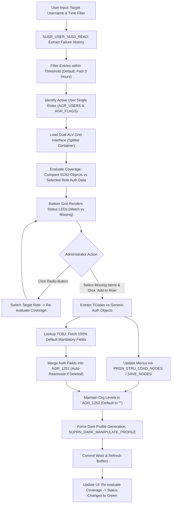

# 🛡️ Z_AUTH_SU53_ANALYZER: SU53 Authorization Analyzer & Role Provisioning Cockpit

> **SAP Basis Utilities & AI-Assisted ABAP Development via Model Context Protocol (MCP)**  
> **Source Code**: [`src/z_auth_su53_analyzer.prog.abap`](../src/z_auth_su53_analyzer.prog.abap)  
> **Repository**: [https://github.com/luongdk18/SAPABAP](https://github.com/luongdk18/SAPABAP)

The ABAP program **`Z_AUTH_SU53_ANALYZER`** (`src/z_auth_su53_analyzer.prog.abap`) is an interactive operational cockpit designed for SAP Security Administrators and Basis Engineers. It automates the end-to-end authorization troubleshooting lifecycle: extracting SU53 failure histories, evaluating coverage across user single roles, simulating assignments, injecting transactions/objects into roles, maintaining Organizational Levels, and forcing background profile regeneration.

---

## 📌 Table of Contents
1. [Business Context & Problem Statement](#1-business-context--problem-statement)
2. [Dual-Grid Cockpit Architecture](#2-dual-grid-cockpit-architecture)
3. [Detailed Processing Workflow](#3-detailed-processing-workflow)
4. [Subroutine Breakdown & Technical Logic](#4-subroutine-breakdown--technical-logic)
   - [4.1. Selection Screen Initialization](#41-selection-screen-initialization)
   - [4.2. SU53 Buffer Extraction (`SUSR_USER_SU53_READ`)](#42-su53-buffer-extraction-susr_user_su53_read)
   - [4.3. Identifying User Single Roles](#43-identifying-user-single-roles)
   - [4.4. Role Coverage Evaluation (`eval_auths_for_role`)](#44-role-coverage-evaluation-eval_auths_for_role)
   - [4.5. PFCG Role Maintenance Engine](#45-pfcg-role-maintenance-engine)
   - [4.6. Data Integrity: 100% Default Field Pass from `TOBJ`](#46-data-integrity-100-default-field-pass-from-tobj)
   - [4.7. Deactivated Object Reactivation (`DELETED = 'X'`)](#47-deactivated-object-reactivation-deleted--x)
   - [4.8. Forced Profile Generation & Org Level Maintenance (`AGR_1252`)](#48-forced-profile-generation--org-level-maintenance-agr_1252)
   - [4.9. UI Event Handling & Command Forwarding](#49-ui-event-handling--command-forwarding)
5. [Summary of Standard SAP Function Modules Used](#5-summary-of-standard-sap-function-modules-used)
6. [Deployment & Operational Guide](#6-deployment--operational-guide)
   - [6.1. Environment Configuration](#61-environment-configuration)
   - [6.2. Three Deployment Methods](#62-three-deployment-methods)
   - [6.3. Transaction Code Setup (SE93)](#63-transaction-code-setup-se93)
   - [6.4. Operational Verification](#64-operational-verification)
7. [Contributing & License](#7-contributing--license)

---

## 1. Business Context & Problem Statement

### Practical Pain Points in SAP Authorization Operations:
1. **Limitations of Standard Transaction `SU53`**: Only captures the *single last failed check* on the current Application Server. When end-users encounter cascading authorization failures across complex workflows (e.g., `ME21N` purchasing, workflow approvals, custom reports), administrators must instruct users to repeat actions repeatedly while collecting screenshots.
2. **Cumbersome Role Lookup**: Administrators must navigate between `SU01` (to view user roles) and `PFCG` (opening each role individually to determine why a missing object is not satisfied).
3. **Loss of Integrity in Manual Additions**: In `PFCG`, manually adding an authorization object while omitting one of its default fields (e.g., `S_ALV_LAYR` requires `ACTVT`, `REPORT`, `HANDLE`, and `LOG_GROUP`) leaves the object in an **Unmaintained (Yellow Triangle)** state. This blocks the SAP Profile Generator from compiling the runtime profile.
4. **Unmaintained Organizational Levels**: Adding transactions or authorization objects often introduces unpopulated Organizational Level variables (such as `$BUKRS`, `$WERKS` in `AGR_1252`), causing Profile Generation to fail with `open_auths` errors.

### The Solution: `Z_AUTH_SU53_ANALYZER` Cockpit
`Z_AUTH_SU53_ANALYZER` unifies the troubleshooting workflow into a single screen: it aggregates all SU53 failures from the past 3 hours, evaluates coverage against the user's active single roles, allows administrators to select missing permissions, and injects them into the chosen role with guaranteed field completeness and immediate profile compilation.

---

## 2. Dual-Grid Cockpit Architecture

The program interface utilizes a linked **Dual-Grid** layout:

```
┌────────────────────────────────────────────────────────────────────────┐
│ TOP CONTAINER (cl_gui_docking_container): SINGLE ROLES LIST             │
│ [Add to Role]  [Select All]  [Deselect All]  [Refresh from SU53]       │
├────┬──────────────────┬────────────────────────────────────────────────┤
│Radio│ Role Name        │ Role Description                               │
├────┼──────────────────┼────────────────────────────────────────────────┤
│🔘  │ Z_ROLE_TEST      │ Purchasing Authorization Role                  │
│⚪  │ Z_MM_PURCHASER   │ Purchasing Operations                          │
└────┴──────────────────┴────────────────────────────────────────────────┘
┌────────────────────────────────────────────────────────────────────────┐
│ BOTTOM CONTAINER: FAILED AUTHORIZATIONS AUDIT LOG                      │
├───┬────────┬───────┬───────┬────────────┬─────────────┬────────────────┤
│Sel│Status  │Object │Field  │Value       │Auth Object D│Evaluation Note │
├───┼────────┼───────┼───────┼────────────┼─────────────┼────────────────┤
│[X]│🔴 Miss │M_EINK_FRT│ACTVT│03          │Release Pur. │Missing in Role │
│[ ]│🟢 Match│S_TCODE│TCD    │ME28        │TCode Check  │Satisfied       │
└───┴────────┴───────┴───────┴────────────┴─────────────┴────────────────┘
```

---

## 3. Detailed Processing Workflow



---

## 4. Subroutine Breakdown & Technical Logic

### 4.1. Selection Screen Initialization
The selection screen accepts the target `P_USER` experiencing authorization failures and a time threshold `P_HOURS` (default: 3 hours).

### 4.2. SU53 Buffer Extraction (`SUSR_USER_SU53_READ`)
Calls standard SAP function module `SUSR_USER_SU53_READ` to retrieve buffered authorization failure logs across application servers.

### 4.3. Identifying User Single Roles
Queries `AGR_USERS` joined with `AGR_FLAGS` to extract all single roles currently assigned to the user, expanding any composite role memberships into their constituent single roles.

### 4.4. Role Coverage Evaluation (`eval_auths_for_role`)
Cross-references every failed authorization check against the currently selected role's data in `AGR_1251` and `AGR_1252`. Renders visual status LEDs:
* **Green LED (`@08@`)**: The permission is already satisfied by the role.
* **Red LED (`@0A@`)**: The permission is missing from the role.

### 4.5. PFCG Role Maintenance Engine
When the administrator clicks **Add to Role**:
* Transaction codes are appended to the role menu structure (`SMENSAPNEW`, `AGR_SHIER`).
* Authorization objects are injected into role authorization buffers.

### 4.6. Data Integrity: 100% Default Field Pass from `TOBJ`
To prevent the classic "Yellow Triangle" incomplete object state in PFCG, the program queries table `TOBJ` and SAP dictionary metadata to ensure **all mandatory fields** belonging to the authorization object are initialized with valid defaults or wildcards.

### 4.7. Deactivated Object Reactivation (`DELETED = 'X'`)
If an authorization object was previously deactivated or marked for deletion in `AGR_1251`, the program resets `DELETED = space`, restoring the object to active status without requiring manual menu reconstruction.

### 4.8. Forced Profile Generation & Org Level Maintenance (`AGR_1252`)
* Any unpopulated Organizational Level variables are defaulted to `'*'` in `AGR_1252`.
* Automatically invokes `SUPRN_DARK_MANIPULATE_PROFILE` in background mode to compile the runtime profile without dialog popups.

### 4.9. UI Event Handling & Command Forwarding
Handles grid events via `cl_gui_alv_grid`: radio button toggling, row selection, toolbar command processing, and real-time coverage updates.

---

## 5. Summary of Standard SAP Function Modules Used

| Function Module | Purpose |
|---|---|
| `SUSR_USER_SU53_READ` | Extracts recent SU53 authorization failure history for the specified user. |
| `PRGN_STRU_LOAD_NODES` | Reads existing role menu hierarchy tree. |
| `PRGN_STRU_SAVE_NODES` | Persists updated menu tree with newly added transactions. |
| `PRGN_1251_READ_AUTH_DATA` | Reads role authorization data buffer (`AGR_1251`). |
| `PRGN_1251_SAVE_AUTH_DATA` | Writes updated authorization data into role buffers. |
| `PRGN_1252_READ_ORG_LEVELS` | Reads Organizational Level values (`AGR_1252`). |
| `PRGN_1252_SAVE_ORG_LEVELS` | Updates Organizational Level values in role buffers. |
| `PRGN_UPDATE_DATABASE` | Flushes role buffers into database tables. |
| `SUPRN_DARK_MANIPULATE_PROFILE` | Recompiles runtime authorization profiles in dark mode. |
| `PRGN_SET_ACTGROUP_TIMESTAMP` | Updates role modification headers in `AGR_DEFINE`. |

---

## 6. Deployment & Operational Guide

### 6.1. Environment Configuration
Configure `.sap.env` with your SAP server connection details:
```ini
SAP_URL=https://your-sap-server.com:44310
SAP_CLIENT=100
SAP_AUTH_TYPE=basic
SAP_USERNAME=YOUR_USER
SAP_PASSWORD=YOUR_PASSWORD
```

### 6.2. Three Deployment Methods

#### Method 1: Automated Deployer (Recommended)
```bash
npm run deploy:su53
# or
node scripts/deploy.js src/z_auth_su53_analyzer.prog.abap Z_AUTH_SU53_ANALYZER
```

#### Method 2: Deploy via Connected AI Assistant
Prompt:
> *"Deploy `src/z_auth_su53_analyzer.prog.abap` as program `Z_AUTH_SU53_ANALYZER` to the connected SAP system and activate it."*

#### Method 3: Manual Deployment (SAP GUI / SE38)
1. Open transaction **`SE38`** in SAP GUI.
2. Enter program name: **`Z_AUTH_SU53_ANALYZER`** -> Click **Create**.
3. Type: `Executable program` (1), Status: `Test program` (T).
4. Save to package **`$TMP`**.
5. Paste code from [`src/z_auth_su53_analyzer.prog.abap`](../src/z_auth_su53_analyzer.prog.abap).
6. Check syntax (`Ctrl + F2`) and **Activate** (`Ctrl + F3`).

### 6.3. Transaction Code Setup (SE93)
1. Open transaction **`SE93`**.
2. Transaction Code: **`ZSU53`** -> Click **Create**.
3. Short Text: `SU53 Authorization Analyzer & Provisioning`.
4. Select: **`Program and selection screen (report transaction)`**.
5. In **Program**, enter: `Z_AUTH_SU53_ANALYZER`.
6. Under **GUI Support**, check SAP GUI for Windows, Java, HTML.
7. Save into `$TMP` or a transport request.

### 6.4. Operational Verification
1. Open SAP GUI and execute: **`/nZSU53`**.
2. Enter the target **User** experiencing authorization errors.
3. Click **Execute** (`F8`).
4. Select the radio button for the target role to receive permissions.
5. Check `[X]` next to missing authorization rows and click **`Add to Role`**.

---

## 7. Contributing & License

This program and documentation are licensed under the MIT License for open-source technical enablement across the SAP Basis and Developer community.
