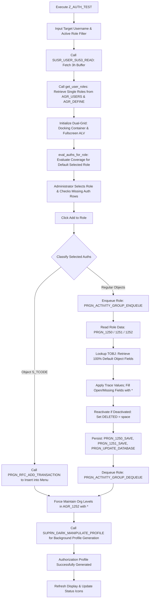

# 🛡️ Z_AUTH_TEST: SU53 Authorization Analyzer & Role Provisioning Cockpit

> **SAP Basis Utilities & AI-Assisted ABAP Development via Model Context Protocol (MCP)**  
> **Author**: luongdk18 | **Repository**: [https://github.com/luongdk18/SAPABAP](https://github.com/luongdk18/SAPABAP)

The ABAP program **`Z_AUTH_TEST`** (`src/z_auth_test.prog.abap`) is an interactive operational cockpit designed for SAP Security Administrators and Basis Engineers. It automates the end-to-end authorization troubleshooting lifecycle: extracting SU53 failure histories, evaluating coverage across user single roles, simulating assignments, injecting transactions/objects into roles, maintaining Organizational Levels, and forcing background profile regeneration.

---

## 📌 Table of Contents
1. [Business Context & Problem Statement](#1-business-context--problem-statement)
2. [Dual-Grid Cockpit Architecture](#2-dual-grid-cockpit-architecture)
3. [Detailed Processing Workflow](#3-detailed-processing-workflow)
4. [Subroutine Breakdown & Technical Logic](#4-subroutine-breakdown--technical-logic)
   - [4.1. Selection Screen Initialization](#41-selection-screen-initialization)
   - [4.2. SU53 Buffer Extraction (`SUSR_USER_SU53_READ`)](#42-su53-buffer-extraction-susr_user_su53_read)
   - [4.3. Identifying User Single Roles](#43-identifying-user-single-roles)
   - [4.4. Role Coverage Evaluation (`eval_auths_for_role`)](#44-role-coverage-evaluation-eval_auths_for_role)
   - [4.5. PFCG Role Maintenance Engine](#45-pfcg-role-maintenance-engine)
   - [4.6. Data Integrity: 100% Default Field Pass from `TOBJ`](#46-data-integrity-100-default-field-pass-from-tobj)
   - [4.7. Deactivated Object Reactivation (`DELETED = 'X'`)](#47-deactivated-object-reactivation-deleted--x)
   - [4.8. Forced Profile Generation & Org Level Maintenance (`AGR_1252`)](#48-forced-profile-generation--org-level-maintenance-agr_1252)
   - [4.9. UI Event Handling & Command Forwarding](#49-ui-event-handling--command-forwarding)
5. [Summary of Standard SAP Function Modules Used](#5-summary-of-standard-sap-function-modules-used)
6. [Deployment & Operational Guide](#6-deployment--operational-guide)
   - [6.1. Clone Repository](#61-clone-repository)
   - [6.2. Environment Configuration](#62-environment-configuration)
   - [6.3. Three Deployment Methods](#63-three-deployment-methods)
   - [6.4. Transaction Code Setup (SE93)](#64-transaction-code-setup-se93)
   - [6.5. Operational Verification](#65-operational-verification)
7. [Contributing & License](#7-contributing--license)

---

## 1. Business Context & Problem Statement

### Practical Pain Points in SAP Authorization Operations:
1. **Limitations of Standard Transaction `SU53`**: Only captures the *single last failed check* on the current Application Server. When end-users encounter cascading authorization failures across complex workflows (e.g., `ME21N` purchasing, workflow approvals, custom reports), administrators must instruct users to repeat actions repeatedly while collecting screenshots.
2. **Cumbersome Role Lookup**: Administrators must navigate between `SU01` (to view user roles) and `PFCG` (opening each role individually to determine why a missing object is not satisfied).
3. **Loss of Integrity in Manual Additions**: In `PFCG`, manually adding an authorization object while omitting one of its default fields (e.g., `S_ALV_LAYR` requires `ACTVT`, `REPORT`, `HANDLE`, and `LOG_GROUP`) leaves the object in an **Unmaintained (Yellow Triangle)** state. This blocks the SAP Profile Generator from compiling the runtime profile.
4. **Unmaintained Organizational Levels**: Adding transactions or authorization objects often introduces unpopulated Organizational Level variables (such as `$BUKRS`, `$WERKS` in `AGR_1252`), causing Profile Generation to fail with `open_auths` errors.

### The Solution: `Z_AUTH_TEST` Cockpit
`Z_AUTH_TEST` unifies the troubleshooting workflow into a single screen: it aggregates all SU53 failures from the past 3 hours, evaluates coverage against the user's active single roles, allows administrators to select missing permissions, and injects them into the chosen role with guaranteed field completeness and immediate profile compilation.

---

## 2. Dual-Grid Cockpit Architecture

The program interface utilizes a linked **Dual-Grid** layout:

```
┌────────────────────────────────────────────────────────────────────────┐
│ TOP CONTAINER (cl_gui_docking_container): SINGLE ROLES LIST             │
│ [Add to Role]  [Select All]  [Deselect All]  [Refresh from SU53]       │
├────┬──────────────────┬────────────────────────────────────────────────┤
│Radio│ Role Name        │ Role Description                               │
├────┼──────────────────┼────────────────────────────────────────────────┤
│🔘  │ Z_ROLE_TEST      │ Purchasing Authorization Role                  │
│⚪  │ Z_MM_PURCHASER   │ Purchasing Operations                          │
└────┴──────────────────┴────────────────────────────────────────────────┘
┌────────────────────────────────────────────────────────────────────────┐
│ BOTTOM AREA (REUSE_ALV_GRID_DISPLAY_LVC): MISSING AUTHORIZATIONS TRACE  │
├───┬──────┬────────────┬─────────────┬──────────────┬───────────────────┤
│Sel│Status│ Object     │ Field       │ Val Required │ Current in Role   │
├───┼──────┼────────────┼─────────────┼──────────────┼───────────────────┤
│[X]│ 🔴   │ S_ALV_LAYR │ ACTVT       │ 23           │                   │
│[X]│ 🔴   │ S_USER_GRP │ ACTVT       │ 03           │                   │
│[ ]│ 🟢   │ S_TCODE    │ TCD         │ ME23N        │ ME23N             │
└───┴──────┴────────────┴─────────────┴──────────────┴───────────────────┘
```

- **Top Grid (Docking Container - `go_docking`)**:
  - Docked at the top of the screen via `cl_gui_docking_container` (`extension = 150`).
  - Displays the target user's Single Roles with interactive radio selection icons (`@06@` / `@05@`).
  - Custom toolbar hosting action buttons: `Add to Role`, `Select All`, `Deselect All`, `Refresh from SU53`.
- **Bottom Grid (Fullscreen ALV Grid)**:
  - Displays authorization check failures extracted from the SU53 buffer, ordered descending by timestamp.
  - Checkbox `SEL`: Enables selecting specific missing checks to inject into the selected role.
  - Status Indicators:
    - 🟢 `@08@` (Green): Check is already satisfied by the currently selected role. The checkbox is automatically disabled.
    - 🔴 `@0A@` (Red): Check is missing or incomplete in the selected role. The checkbox is enabled for selection.

---

## 3. Detailed Processing Workflow



---

## 4. Subroutine Breakdown & Technical Logic

### 4.1. Selection Screen Initialization
- **Screen Declaration**:
  ```abap
  PARAMETERS: p_uname TYPE usr02-bname DEFAULT sy-uname OBLIGATORY,
              p_actv  TYPE abap_bool AS CHECKBOX DEFAULT 'X'.
  ```
  - `p_uname`: Username to inspect (defaults to current session user).
  - `p_actv`: Restricts role lookup to active assignments (`from_dat <= sy-datum <= to_dat`).

### 4.2. SU53 Buffer Extraction (`SUSR_USER_SU53_READ`)
- **Subroutine `get_missing_authorizations`**:
  - Calculates timestamp for 3 hours prior using `cl_abap_tstmp=>subtractsecs`:
    ```abap
    GET TIME STAMP FIELD lv_from.
    cl_abap_tstmp=>subtractsecs( EXPORTING tstmp = lv_from secs = 10800 RECEIVING r_tstmp = lv_from ).
    ```
  - Calls standard SAP function module:
    ```abap
    CALL FUNCTION 'SUSR_USER_SU53_READ'
      EXPORTING
        iv_bname       = p_uname
        iv_from        = lv_from
        iv_all_servers = 'X'
      IMPORTING
        et_usr07_ext   = lt_su53_raw.
    ```
  - **Field & Value Extraction**: Iterates across the 10 field pairs `fiel1..fiel10` and `val01..val10` in `usr07_ext`, filters out dummy values (`dummyfield`), and retrieves object descriptions from `TOBJT` using logon language (`sy-langu`) or English fallback (`E`).

### 4.3. Identifying User Single Roles
- **Subroutine `get_user_roles`**:
  - Reads assignments from table `AGR_USERS` matching the specified user.
  - Queries `AGR_DEFINE` to **exclude Collective/Composite Roles** (`kollektive = space`), retaining only Single Roles that directly maintain authorization objects.

### 4.4. Role Coverage Evaluation (`eval_auths_for_role`)
- **Subroutine `eval_auths_for_role`**:
  - **Filters Out Deactivated Objects**:
    ```abap
    SELECT object, auth, field, low, high
      FROM agr_1251
      WHERE agr_name = @pv_role
        AND deleted  = ' '
      INTO TABLE @lt_role_flds.

    SELECT object, auth
      FROM agr_1250
      WHERE agr_name = @pv_role
        AND deleted  = ' '
      INTO TABLE @lt_role_objs.
    ```
    > 💡 **Key Design Rule**: Enforcing `AND deleted = ' '` ensures deactivated authorizations in PFCG are not mistakenly marked as satisfied. Deactivated objects are treated as 🔴 Missing.
  - **AND/OR Coverage Logic**: An authorization instance (`auth`) satisfies a trace check if it satisfies **all** fields evaluated during that check event (AND). If **any** active instance in the role satisfies all fields, the check is considered covered (OR). Supports exact matches, wildcards (`*`), and range boundaries (`low <= value <= high`).

### 4.5. PFCG Role Maintenance Engine
- **Subroutine `add_selected_auths_to_role`**:
  - Processes only lines where `sel = 'X'` and `is_in_role = abap_false`.
  - **Special Handling for Object `S_TCODE`**:
    For transaction start permissions (`S_TCODE`), the program **does not insert directly into AGR_1251** (which creates non-standard manual objects). Instead, it injects the transaction into the PFCG Menu tree:
    ```abap
    CALL FUNCTION 'PRGN_RFC_ADD_TRANSACTION'
      EXPORTING
        activity_group = pv_role
        tcode          = lv_tcode.
    ```
  - **Enqueue Lock Management**:
    Locks the role before making modifications:
    ```abap
    CALL FUNCTION 'PRGN_ACTIVITY_GROUP_ENQUEUE'
      EXPORTING
        activity_group = gv_selected_role
      EXCEPTIONS
        foreign_lock   = 1
        OTHERS         = 2.
    ```
    If another user is currently editing the role in PFCG (`sy-subrc = 1`), `sy-msgv1` contains the exact lock owner. The cockpit alerts the user: *"Role X is locked by user Y. Please exit Edit mode in PFCG first..."*.

### 4.6. Data Integrity: 100% Default Field Pass from `TOBJ`
This critical feature prevents authorization objects from remaining in an unmaintained state:
```abap
  " Retrieve all default fields registered for the object in TOBJ
  SELECT SINGLE fiel1, fiel2, fiel3, fiel4, fiel5, fiel6, fiel7, fiel8, fiel9, fiel0
    FROM tobj
    WHERE objct = @ls_item-object
    INTO CORRESPONDING FIELDS OF @ls_tobj_def.

  " Iterate across all registered fields
  LOOP AT lt_def_fields INTO DATA(lv_df).
    READ TABLE ls_item-check_values INTO DATA(ls_scv) WITH KEY field = lv_df.
    IF sy-subrc = 0 AND ls_scv-value IS NOT INITIAL.
      lv_df_val = ls_scv-value.      " Field was present in trace: take trace value
    ELSE.
      lv_df_val = '*'.               " Field omitted in trace: populate wildcard '*'
    ENDIF.
    ...
  ENDLOOP.
```
- **Example**: When adding object `S_ALV_LAYR` (trace indicated `ACTVT = 23`, `REPORT = SAPLMEGUI`, `HANDLE = RIOV`, `LOG_GROUP = ''`):
  - `ACTVT` -> Assigned `23`
  - `REPORT` -> Assigned `SAPLMEGUI`
  - `HANDLE` -> Assigned `RIOV`
  - `LOG_GROUP` -> Assigned `*`
  - All 4 fields are persisted to `AGR_1251`, achieving a completely maintained (green) status in PFCG.

### 4.7. Deactivated Object Reactivation (`DELETED = 'X'`)
- In subroutine `ensure_role_auth` and field update routines:
  ```abap
  <ls_auth>-modified = 'U'.
  <ls_auth>-deleted  = ' '.  " Clear deletion flag to reactivate object
  ```
  If the target role already contained the object in a deactivated state, the program restores it to Active and updates field values rather than creating duplicate instances.

### 4.8. Forced Profile Generation & Org Level Maintenance (`AGR_1252`)
- **Subroutine `generate_role_profile`**:
  - **Auto-populating Organizational Levels (`AGR_1252`)**:
    Adding menu items or objects can create Organizational Level variables (`$BUKRS`, `$WERKS`, `$EKORG`, etc.) with null values. The subroutine scans via `PRGN_1252_READ_ORG_LEVELS`, assigns `low = '*'` to unpopulated variables, and commits them via `PRGN_1252_SAVE_ORG_LEVELS` + `PRGN_UPDATE_DATABASE`.
  - **Background Profile Generation**:
    ```abap
    CALL FUNCTION 'SUPRN_DARK_MANIPULATE_PROFILE'
      EXPORTING
        activity_group        = pv_role
        fill_orgs_with_star   = 'X'    " Automatically fill open Org Levels with *
        fill_fields_with_star = 'X'    " Automatically fill open fields with *
        no_dialog             = 'X'    " Suppress interactive popups
        rebuild_auth_data     = pv_rebuild
        generate_profile      = 'X'    " Trigger immediate generation
    ```
  - **Fallback Handling**: If `SUPRN_DARK_MANIPULATE_PROFILE` encounters warnings, the program triggers `PRGN_AUTO_GENERATE_PROFILE_NEW` with flags `org_levels_with_star = 'X'` and `fill_empty_fields_with_star = 'X'`.

### 4.9. UI Event Handling & Command Forwarding
- **Subroutines `on_user_command_roles` & `handle_user_command`**:
  - Prevents SAP GUI Automation Queue deadlocks by decoupling grid events:
  - The docking container event handler forwards commands using:
    ```abap
    cl_gui_cfw=>set_new_ok_code( e_ucomm ).
    ```
  - The central screen controller (`handle_user_command`) executes user actions: `ADD_ROLE`, `SEL_ALL`, `DESEL_ALL`, and `REFRESH`.

---

## 5. Summary of Standard SAP Function Modules Used

| Function Module | Operational Purpose |
| :--- | :--- |
| `SUSR_USER_SU53_READ` | Extracts authorization trace failure buffer for target user |
| `PRGN_ACTIVITY_GROUP_ENQUEUE` | Locks role prior to editing authorization data |
| `PRGN_ACTIVITY_GROUP_DEQUEUE` | Releases role lock following updates |
| `PRGN_RFC_ADD_TRANSACTION` | Inserts transaction codes into the standard PFCG Role Menu |
| `PRGN_1250_READ_AUTH_DATA` | Reads authorization objects and instances (`AGR_1250`) |
| `PRGN_1250_SAVE_AUTH_DATA` | Persists authorization objects and instances (`AGR_1250`) |
| `PRGN_1251_READ_FIELD_VALUES` | Reads authorization fields and values (`AGR_1251`) |
| `PRGN_1251_SAVE_FIELD_VALUES` | Persists authorization fields and values (`AGR_1251`) |
| `PRGN_1252_READ_ORG_LEVELS` | Reads Organizational Level variables (`AGR_1252`) |
| `PRGN_1252_SAVE_ORG_LEVELS` | Persists Organizational Level variables (`AGR_1252`) |
| `PRGN_UPDATE_DATABASE` | Commits staged role buffer updates to the database |
| `SUPRN_DARK_MANIPULATE_PROFILE`| Generates authorization profiles in background mode |
| `PRGN_AUTO_GENERATE_PROFILE_NEW`| Fallback profile generator function module |
| `REUSE_ALV_GRID_DISPLAY_LVC` | Renders fullscreen ALV Grid of missing authorizations |

---

## 6. Deployment & Operational Guide

### 6.1. Clone Repository
```bash
git clone https://github.com/luongdk18/SAPABAP.git
cd SAPABAP
```

### 6.2. Environment Configuration
1. Copy the environment configuration template:
   - **Windows PowerShell**:
     ```powershell
     Copy-Item .sap.env.example .sap.env
     ```
   - **macOS / Linux**:
     ```bash
     cp .sap.env.example .sap.env
     ```
2. Configure `.sap.env` with your SAP server connection details:
   ```ini
   SAP_URL=https://your-sap-server.com:44310
   SAP_CLIENT=100
   SAP_AUTH_TYPE=basic
   SAP_SYSTEM_TYPE=onprem
   SAP_USERNAME=YOUR_USER
   SAP_PASSWORD=YOUR_PASSWORD
   SAP_LANGUAGE=EN
   SAP_MASTER_SYSTEM=DEV
   NODE_TLS_REJECT_UNAUTHORIZED=0
   ```
   > 🔒 **Security Notice**: `.sap.env` is excluded by `.gitignore`. Never commit credentials.

---

### 6.3. Three Deployment Methods

#### Method 1: Selective CLI Script (Recommended)
Use the included automated deployer [`scripts/deploy.js`](../scripts/deploy.js). It communicates with the SAP ADT MCP server to lock, upload to `$TMP`, check syntax, and activate the program remotely.

1. Ensure Node.js (>= 22) and MCP CLI are installed:
   ```bash
   npm install -g @mcp-abap-adt/core
   ```
2. Deploy the program:
   ```bash
   # Deploy specifically Z_AUTH_TEST
   npm run deploy -- Z_AUTH_TEST

   # Or run interactively to choose from available programs:
   npm run deploy
   ```
3. Console output confirms activation:
   ```text
   📦 Deploying Z_AUTH_TEST (66942 characters)...
   🔌 Starting SAP ADT MCP Server with environment: .sap.env
   🚀 Checking and deploying program Z_AUTH_TEST on SAP...
   ✅ Success! Program Z_AUTH_TEST updated and activated successfully.
   ```

#### Method 2: Deploy via Connected AI Assistant
In any MCP-connected AI assistant (**Grok Build**, **ChatGPT / Codex**, **Claude Desktop**, **Cursor IDE**, or **Google Antigravity**):
- Provide prompt:
  > *"Deploy `src/z_auth_test.prog.abap` as program `Z_AUTH_TEST` to the connected SAP system and activate it."*
- The assistant reads the file and invokes ADT tools (`UpdateProgram`/`CreateProgram` and `ActivateProgram`) automatically.

#### Method 3: Manual Deployment (SAP GUI / SE38)
1. Open transaction **`SE38`** in SAP GUI.
2. Enter program name: **`Z_AUTH_TEST`** -> Click **Create**.
3. Set attributes:
   - **Title**: `SU53 Authorization Trace and Simulator`
   - **Type**: `Executable program` (1)
   - **Status**: `Test program` (T)
4. Save to package **`$TMP`** (Local Object) or your target development package.
5. Open [`src/z_auth_test.prog.abap`](../src/z_auth_test.prog.abap), copy all source code, and paste into SE38.
6. Check syntax (`Ctrl + F2`) and **Activate** (`Ctrl + F3`).

---

### 6.4. Transaction Code Setup (SE93)
To provide easy execution for basis administrators:
1. Open transaction **`SE93`**.
2. Transaction Code: **`ZAT`** -> Click **Create**.
3. Short Text: `SU53 Role Assignment Simulator`.
4. Select: **`Program and selection screen (report transaction)`** -> Enter.
5. In **Program**, enter: `Z_AUTH_TEST`.
6. Under **GUI Support**, check all 3 boxes (SAP GUI for Windows, Java, and HTML).
7. Save into `$TMP` or a transport request.

---

### 6.5. Operational Verification
1. Open SAP GUI and execute: **`/nZAT`**.
2. Enter the target **User** experiencing authorization errors.
3. Click **Execute** (`F8`):
   - Missing authorization checks from the past 3 hours appear in the bottom grid.
   - User single roles appear in the top grid.
4. Select the radio button for the target role to receive permissions.
5. Check `[X]` next to missing authorization rows and click **`Add to Role`**:
   - The program injects TCodes into menus and creates authorization objects with 100% standard fields (`TOBJ`).
   - Automatically maintains Organizational Levels in `AGR_1252` with wildcards.
   - Automatically generates the authorization profile in background mode without manual PFCG actions.

---

## 7. Contributing & License

This program and documentation are licensed under the [MIT License](../README.md#license) for open-source technical enablement across the SAP Basis and Developer community.

Feedback, bug reports, and pull requests are welcome via [GitHub Issues](https://github.com/luongdk18/SAPABAP/issues) or directly to [@luongdk18](https://github.com/luongdk18).
