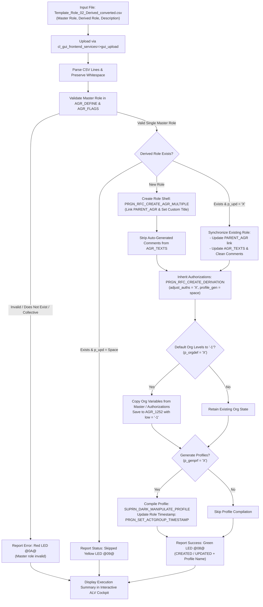

# 🧬 Z_ROLE_02_CREATE_DERIVE: Batch PFCG Derived Role Creation & Inheritance Synchronization

> **SAP Basis Utilities & AI-Assisted ABAP Development via Model Context Protocol (MCP)**  
> **Source Code**: [`src/z_role_02_create_derive.prog.abap`](../src/z_role_02_create_derive.prog.abap)  
> **Companion Script**: [`scripts/convert_role_02_derive.py`](../scripts/convert_role_02_derive.py)  
> **Conversion Guide**: [`docs/ROLE_CONVERSION_GUIDE.md`](ROLE_CONVERSION_GUIDE.md)  
> **Repository**: [https://github.com/luongdk18/SAPABAP](https://github.com/luongdk18/SAPABAP)

The ABAP utility **`Z_ROLE_02_CREATE_DERIVE`** is an enterprise-grade automation tool for SAP Security Administrators and Authorization Architects. It automates the mass generation of **Derived Single Roles** (imparted roles) from existing **Master Roles** (parent template roles) directly from flat CSV data. 

The program establishes the formal derivation link (`PARENT_AGR`), inherits complete menu structures and authorizations, initializes Organizational Levels to a secure template default (`-1`), suppresses intrusive automatic SAP comment lines, and compiles background runtime authorization profiles without requiring tedious manual intervention in transaction `PFCG`.

---

## 📌 Table of Contents
1. [Business Context & Problem Statement](#1-business-context--problem-statement)
2. [End-to-End Processing Workflow](#2-end-to-end-processing-workflow)
3. [Key Architectural & Functional Features](#3-key-architectural--functional-features)
   - [3.1. Master Role Integrity & Type Verification](#31-master-role-integrity--type-verification)
   - [3.2. Derived Role Definition & Clean Description Handling](#32-derived-role-definition--clean-description-handling)
   - [3.3. Menu Inheritance & Authorization Transfer](#33-menu-inheritance--authorization-transfer)
   - [3.4. Secure Org Level Initialization (`-1` Safety Architecture)](#34-secure-org-level-initialization--1-safety-architecture)
   - [3.5. Background Profile Generation](#35-background-profile-generation)
   - [3.6. Idempotent Synchronization & Update Mode](#36-idempotent-synchronization--update-mode)
   - [3.7. Interactive ALV Cockpit with Direct PFCG Navigation](#37-interactive-alv-cockpit-with-direct-pfcg-navigation)
4. [Selection Screen & Operational Options](#4-selection-screen--operational-options)
5. [Standard SAP Function Modules & Database Tables](#5-standard-sap-function-modules--database-tables)
6. [Operational Step-by-Step Guide](#6-operational-step-by-step-guide)
7. [Troubleshooting & Frequently Asked Questions (FAQ)](#7-troubleshooting--frequently-asked-questions-faq)

---

## 1. Business Context & Problem Statement

In enterprise SAP authorization architectures, the **Master / Derived Role model** is the industry standard for scaling security across complex organizational structures (multiple Company Codes, Plants, Purchasing Organizations, Sales Organizations).

* **Master Roles** contain the functional authorizations (Transactions, Authorization Objects, Activities) and menu folder structures, while keeping Organizational Levels unmaintained or templated (`-1`).
* **Derived Roles** inherit the menu and authorization objects identically from their master role, differing **only** in their specific Organizational Level values (e.g. Company Code `1000` vs. `2000`).

### Operational Bottlenecks in Standard PFCG:
1. **Manual Derivation at Scale is Error-Prone**: Deriving 50–100 operational roles across entities via transaction `PFCG` requires manually clicking *Create Role*, setting the *Inheriting Role* field, copying auth data, and adjusting fields one by one.
2. **Missing Org Level Dumps & Red Status**: Generating profiles immediately upon derivation often triggers warning popups or profile compilation dumps because Organizational Levels have not yet been initialized.
3. **Menu Inconsistencies**: Without automated synchronization, derived roles easily fall out of sync when functional master roles are updated.
4. **Cluttered System Comments**: Standard SAP automatically appends boilerplates like `"The role was created automatically and can be processed manually."` to `AGR_TEXTS`, cluttering role search dialogs.

`Z_ROLE_02_CREATE_DERIVE` addresses all these challenges in a single, automated, repeatable batch transaction.

---

## 2. End-to-End Processing Workflow



---

## 3. Key Architectural & Functional Features

### 3.1. Master Role Integrity & Type Verification
Before attempting to create or synchronize any derived role, `Z_ROLE_02_CREATE_DERIVE` performs rigorous checks:
* **Existence in `AGR_DEFINE`**: Verifies that the Master Role actually exists in the target SAP system.
* **Role Type Verification**: Inspects table `AGR_FLAGS` (`flag_type = 'COLL_AGR'`). Collective roles **cannot** be used as master template roles. Any derivation attempt targeting a collective role is blocked with a descriptive error.
* **Master Description Lookup**: Pulls the master role's description from `AGR_TEXTS` for clear correlation in the ALV cockpit.

### 3.2. Derived Role Definition & Clean Description Handling
* Calls `PRGN_RFC_CREATE_AGR_MULTIPLE` with `parent_role` populated. This assigns `AGR_DEFINE-PARENT_AGR` natively in standard SAP tables.
* **Whitespace Preservation**: Custom descriptions from column 3 are stored without destructive `CONDENSE`, preserving business formatting.
* **Comment Line Sanitization**: Standard SAP modules write generic comments (`line > '00000'`) into `AGR_TEXTS`. `Z_ROLE_02_CREATE_DERIVE` deletes these redundant lines, leaving only the official single-line business title.

### 3.3. Menu Inheritance & Authorization Transfer
* Calls standard SAP function module `PRGN_RFC_CREATE_DERIVATION` with `adjust_auths = 'X'`.
* Automatically copies the full transaction menu and all authorization objects/fields from the master role to the derived role.
* Menu editing is disabled on the derived role in standard PFCG, maintaining structural integrity with the master template.

### 3.4. Secure Org Level Initialization (`-1` Safety Architecture)
Standard derivation often leaves Organizational Levels unmaintained, causing red authorization status lights in `PFCG` or runtime authorization check dumps. 
When **Default Org Levels to "-1"** is active (`p_orgdef = 'X'`):
1. Reads all required Org Level variables from the Master Role (`AGR_1252`).
2. If none exist in the master role, scans authorization data (`AGR_1251`) for all fields bound to `$*` variables.
3. Automatically sets all Org Level variables to `'-1'` via `PRGN_1252_SAVE_ORG_LEVELS` and commits via `PRGN_UPDATE_DATABASE`.
4. **Safety Benefit**: A value of `'-1'` prevents broad wildcard (`'*'`) access leaks while allowing authorization profiles to compile cleanly in the background.

### 3.5. Background Profile Generation
* Compiles runtime authorization profiles in dark mode via `SUPRN_DARK_MANIPULATE_PROFILE` (`generate_profile = 'X'`, `no_dialog = 'X'`).
* Defers profile compilation until **after** Org Levels are safely initialized to `-1`, eliminating profile compilation failures.
* Updates role modification timestamps via `PRGN_SET_ACTGROUP_TIMESTAMP` and queries the generated profile name from `AGR_1016`.

### 3.6. Idempotent Synchronization & Update Mode
When **Update Existing Derived Roles** (`p_upd = 'X'`) is selected:
* If the derived role already exists, its `PARENT_AGR` link is synchronized.
* Descriptions are refreshed in `AGR_TEXTS`.
* Authorization data is re-inherited and re-adjusted from the Master Role, ensuring newly added authorizations on the master role propagate downstream cleanly.

### 3.7. Interactive ALV Cockpit with Direct PFCG Navigation
The report displays comprehensive audit logs in an ALV grid (`CL_SALV_TABLE`):
* **Status Icons**: `@08@` (Green LED - Success), `@09@` (Yellow LED - Warning / Skipped), `@0A@` (Red LED - Error).
* **Two-Way Hotspot Jumps**:
  * Clicking any cell in column **Derived Role** directly opens that derived role in transaction `PFCG`.
  * Clicking any cell in column **Master Role** directly opens the parent master role in transaction `PFCG`.

---

## 4. Selection Screen & Operational Options

```text
╔══════════════════════════════════════════════════════════════════════════╗
║ Selection Screen: Z_ROLE_02_CREATE_DERIVE                                ║
╠══════════════════════════════════════════════════════════════════════════╣
║ [Input CSV File (.csv)]                                                  ║
║   File Path:             [ D:\PROJECTS\SAPABAP\excel-templates\... ] 📁 ║
║                                                                          ║
║ [Execution & Derivation Options]                                         ║
║   [X] Simulation (Test Run)                                              ║
║   [X] Update Existing Derived Roles                                      ║
║   [X] Inherit / Adjust Auth from Master                                  ║
║   [X] Auto-Generate Auth Profiles                                        ║
║   [X] Default Org Levels to "-1"                                         ║
╚══════════════════════════════════════════════════════════════════════════╝
```

| Parameter | Technical Name | Default | Description |
| :--- | :--- | :--- | :--- |
| **File Path** | `p_file` | *Empty* | Path to the 3-column CSV file (`Master Role`, `Derived Role`, `Derived Description`). |
| **Simulation (Test Run)** | `p_test` | `'X'` | Validates master roles, role names, and displays planned actions without writing to SAP database. |
| **Update Existing Derived Roles** | `p_upd` | `'X'` | If checked, updates existing derived roles and re-syncs authorizations. If unchecked, skips existing roles. |
| **Inherit / Adjust Auth from Master** | `p_adjust` | `'X'` | Propagates authorization data from master role via `PRGN_RFC_CREATE_DERIVATION`. |
| **Auto-Generate Auth Profiles** | `p_genprf` | `'X'` | Compiles runtime authorization profiles in dark mode via `SUPRN_DARK_MANIPULATE_PROFILE`. |
| **Default Org Levels to "-1"** | `p_orgdef` | `'X'` | Initializes Org Levels in `AGR_1252` to `'-1'` to allow clean profile generation without security leaks. |

---

## 5. Standard SAP Function Modules & Database Tables

### Function Modules
| Function Module | Purpose |
| :--- | :--- |
| `PRGN_RFC_CREATE_AGR_MULTIPLE` | Creates the derived role shell definition and establishes `PARENT_AGR` link. |
| `PRGN_RFC_CREATE_DERIVATION` | Synchronizes authorizations and menus from master role to derived role. |
| `PRGN_1252_SAVE_ORG_LEVELS` | Writes organizational level entries (`PT1252`) into memory buffers. |
| `PRGN_UPDATE_DATABASE` | Flushes role buffers into database tables (`AGR_1252`, `AGR_1251`). |
| `SUPRN_DARK_MANIPULATE_PROFILE` | Generates and compiles runtime authorization profiles (`XUPROFILE`) in background mode. |
| `PRGN_SET_ACTGROUP_TIMESTAMP` | Updates role modification headers (`AGR_DEFINE-CHANGE_DAT/TIM`). |

### Database Tables
| Table | Description | Usage in Program |
| :--- | :--- | :--- |
| `AGR_DEFINE` | Role definitions | Validates master role existence, checks `PARENT_AGR`. |
| `AGR_FLAGS` | Role attributes | Verifies Master Role is not a collective role (`COLL_AGR`). |
| `AGR_TEXTS` | Role titles & descriptions | Synchronizes descriptions and cleans up automatic comment lines. |
| `AGR_1251` | Authorization object data | Validates field references and variable bindings (`$*`). |
| `AGR_1252` | Organizational level values | Reads master org levels and initializes derived role org levels to `-1`. |
| `AGR_1016` | Role-to-Profile relationships | Retrieves generated profile names for display in the ALV report. |

---

## 6. Operational Step-by-Step Guide

### Step 1: Prepare Mapping Data with Python Preprocessor
Prepare your derived role spreadsheet (e.g. `Template_Role_02_Derived.xlsx` or working copy in `excel-working/`) and run the conversion script:
```bash
npm run convert:role:02
# Output generated: excel-templates/Template_Role_02_Derived_converted.csv
```

### Step 2: Launch `Z_ROLE_02_CREATE_DERIVE` in SAP
1. Open transaction **`SE38`** or **`SA38`**.
2. Enter program name: `Z_ROLE_02_CREATE_DERIVE` and click **Execute (F8)**.
3. Browse and select the converted `.csv` file.
4. Keep **Simulation (Test Run)** checked (`p_test = 'X'`).
5. Execute to review planned actions.

### Step 3: Verify Simulation Results in ALV Grid
Review the ALV table:
* Ensure Master Roles are marked with **Green LED (`@08@`)**.
* If any Master Role is missing or misspelled in your CSV, it will show **Red LED (`@0A@`)** with message: `Master role '...' does not exist in SAP.`
* Click on role names in the ALV to jump to `PFCG` if you need to inspect existing configuration.

### Step 4: Execute Live Derivation
1. Return to the selection screen (**F3**).
2. Uncheck **Simulation (Test Run)** (`p_test = space`).
3. Ensure **Auto-Generate Auth Profiles** and **Default Org Levels to "-1"** are checked.
4. Execute (**F8**).
5. All derived roles will be created, authorizations inherited, Org Levels defaulted to `-1`, and profiles generated.

---

## 7. Troubleshooting & Frequently Asked Questions (FAQ)

### Q1: Why does the program report: *"Master role is a collective role; cannot derive from collective role"*?
**Answer**: In SAP PFCG architecture, derived roles can only inherit from **Single Roles**. A collective role is merely a container of other roles and contains no authorization objects or menus of its own. Check the role matrix and replace the master role with an appropriate single master role.

### Q2: Why are Organizational Levels set to `'-1'` instead of leaving them empty?
**Answer**: If Org Levels are left completely empty, SAP's profile generation engine will either flag the role as having unmaintained org levels (Yellow or Red status) or prompt interactively for input. Defaulting to `'-1'` allows profiles to compile cleanly in background mode while ensuring no broad authorization (`'*'`) is inadvertently granted before the specialized Org values are imported via `Z_ROLE_03_UPDATE_ORG`.

### Q3: How do I handle new authorizations added to the Master Role later?
**Answer**: Simply rerun `Z_ROLE_02_CREATE_DERIVE` with the same CSV file and ensure **Update Existing Derived Roles** (`p_upd = 'X'`) and **Inherit / Adjust Auth from Master** (`p_adjust = 'X'`) are checked. The program will automatically update existing derived roles, pull the latest master authorizations, and regenerate profiles.
