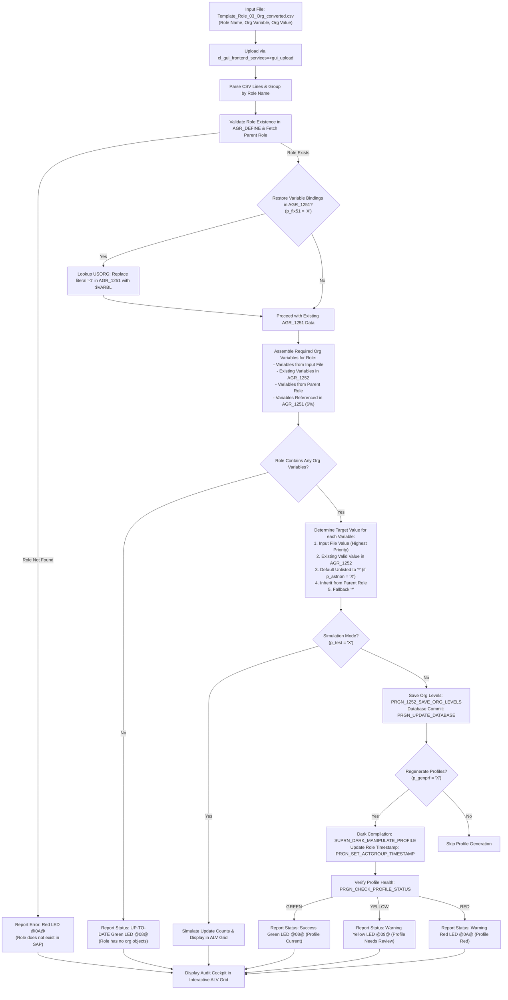

# 🏢 Z_ROLE_03_UPDATE_ORG: Batch Organizational Levels Maintenance & Profile Regeneration

> **SAP Basis Utilities & AI-Assisted ABAP Development via Model Context Protocol (MCP)**  
> **Source Code**: [`src/z_role_03_update_org.prog.abap`](../src/z_role_03_update_org.prog.abap)  
> **Companion Script**: [`scripts/convert_role_03_org.py`](../scripts/convert_role_03_org.py)  
> **Org Levels Reference**: [`excel-templates/Org_Levels.csv`](../excel-templates/Org_Levels.csv)  
> **Conversion Guide**: [`docs/ROLE_CONVERSION_GUIDE.md`](ROLE_CONVERSION_GUIDE.md)  
> **Repository**: [https://github.com/luongdk18/SAPABAP](https://github.com/luongdk18/SAPABAP)

The ABAP utility **`Z_ROLE_03_UPDATE_ORG`** is an operational cockpit designed for SAP Basis Administrators, Security Consultants, and Authorization Managers. It automates the mass maintenance and update of **Organizational Levels** (`AGR_1252`) across hundreds of SAP Single and Derived Roles directly from flat CSV data.

The program reads mapped organizational variables (`$BUKRS`, `$WERKS`, `$EKORG`, `$VKORG`, etc.), ensures proper synchronization with underlying authorization objects (`AGR_1251`) via SAP table `USORG`, automatically defaults unmaintained organizational levels to wildcard (`*`) when configured to guarantee a **GREEN** profile status, regenerates authorization profiles in dark mode, and reports execution details in an interactive ALV grid with one-click navigation to transaction `PFCG`.

---

## 📌 Table of Contents
1. [Business Context & Problem Statement](#1-business-context--problem-statement)
2. [End-to-End Processing Workflow](#2-end-to-end-processing-workflow)
3. [Key Architectural & Functional Features](#3-key-architectural--functional-features)
   - [3.1. Automatic Variable Normalization (`$VARBL`) & Range Support](#31-automatic-variable-normalization-varbl--range-support)
   - [3.2. Multi-Tier Organizational Level Resolution](#32-multi-tier-organizational-level-resolution)
   - [3.3. USORG Field Mapping & AGR_1251 Binding Restoration (`p_fix51`)](#33-usorg-field-mapping--agr_1251-binding-restoration-p_fix51)
   - [3.4. Guaranteed Green Status: Default Unlisted Org Levels to `*` (`p_astnon`)](#34-guaranteed-green-status-default-unlisted-org-levels-to--p_astnon)
   - [3.5. Standard Database Updates (`PRGN_1252_SAVE_ORG_LEVELS`)](#35-standard-database-updates-prgn_1252_save_org_levels)
   - [3.6. Automated Background Profile Compilation & Status Check](#36-automated-background-profile-compilation--status-check)
   - [3.7. Interactive ALV Cockpit with Direct PFCG Navigation](#37-interactive-alv-cockpit-with-direct-pfcg-navigation)
4. [Selection Screen & Operational Options](#4-selection-screen--operational-options)
5. [Standard SAP Function Modules & Database Tables](#5-standard-sap-function-modules--database-tables)
6. [Operational Step-by-Step Guide](#6-operational-step-by-step-guide)
7. [Troubleshooting & Frequently Asked Questions (FAQ)](#7-troubleshooting--frequently-asked-questions-faq)

---

## 1. Business Context & Problem Statement

In enterprise SAP rollouts, each functional template role (Master Role) is derived into dozens of legal entities, operating units, sales areas, or plant variants (Derived Roles). Maintaining Organizational Levels across these derived roles is one of the most labor-intensive and error-prone activities in SAP security.

### Operational Challenges in Standard PFCG:
1. **Click-Heavy Manual Maintenance**: Updating 10 organizational levels across 100 derived roles requires opening transaction `PFCG` 100 times, clicking into the *Authorizations* tab, opening the *Organizational Levels* dialog, entering values, clicking *Transfer Values*, and regenerating profiles.
2. **The "Red Org Level" Epidemic**: When derived roles are generated from templates, unassigned Org Levels remain empty or initialized to `'-1'`. SAP flags these roles with a **Red Authorization Status** (`Status: Not Maintained`), preventing end users from executing business transactions.
3. **Corrupted Variable Bindings in `AGR_1251`**: In some derivation scenarios or automated imports, authorization field values in `AGR_1251-LOW` are inadvertently overwritten with literal strings (such as `'-1'`) instead of retaining their dynamic variable pointers (e.g. `$BUKRS`), severing the link between the Org Level dialog and the concrete authorization objects.
4. **Lack of Mass Auditing & Validation**: Standard SAP offers no transaction to view a tabular comparison between business matrix expectations and actual database values in `AGR_1252`.

`Z_ROLE_03_UPDATE_ORG` completely automates this process, updating organizational levels in batch, healing corrupted variable pointers, and generating clean profiles in seconds.

---

## 2. End-to-End Processing Workflow



---

## 3. Key Architectural & Functional Features

### 3.1. Automatic Variable Normalization (`$VARBL`) & Range Support
* The program handles both formats seamlessly: `BUKRS` or `$BUKRS`. If the leading `$` prefix is omitted in the input file, it is automatically prepended.
* Supports single values (e.g. `1000`, `*`), wildcards (e.g. `10*`), and interval ranges (e.g. `1000 - 1050` or `1000:1050`). Ranges are automatically parsed into `VAL_LOW` and `VAL_HIGH`.

### 3.2. Multi-Tier Organizational Level Resolution
When determining the final value for any Organizational Level variable in a role, the program follows a deterministic 5-priority cascade:
1. **Priority 1 (Input CSV File)**: Explicit values specified in the uploaded file always take highest precedence.
2. **Priority 2 (Existing Maintained Value)**: If the variable was already populated with a valid business value in `AGR_1252` (not blank, not `$`, and not `'-1'`), that value is preserved.
3. **Priority 3 (Default Unlisted to `*`)**: If parameter `p_astnon = 'X'` is enabled, any required Org Level not explicitly listed in the input file is assigned `'*'` (full access).
4. **Priority 4 (Inherited from Parent Master Role)**: If `p_astnon` is inactive, the program attempts to inherit the value from the parent master role (`PARENT_AGR`).
5. **Priority 5 (Fallback Wildcard)**: If no value can be inherited, it defaults to `'*'` to prevent profile compilation failure.

### 3.3. USORG Field Mapping & AGR_1251 Binding Restoration (`p_fix51`)
When derived roles are generated or manipulated, field entries in `AGR_1251` can become severed if `LOW` is set to literal `'-1'`:
* `Z_ROLE_03_UPDATE_ORG` queries SAP control table `USORG` to map authorization fields back to their corresponding organizational variables (e.g. field `BUKRS` maps to `$BUKRS`).
* When **Restore Variables in AGR_1251** is checked (`p_fix51 = 'X'`), it automatically repairs broken `-1` values in `AGR_1251-LOW`, reconnecting the authorization field to the Org Level variable before saving.

### 3.4. Guaranteed Green Status: Default Unlisted Org Levels to `*` (`p_astnon`)
In many role matrices, business analysts only specify the key differentiating organizational values (e.g. Company Code and Plant), leaving other secondary org levels (such as Profit Center or Storage Location) to be company-wide.
* Enabling **Default Unlisted Org Levels to \*** (`p_astnon = 'X'`) ensures that all unmentioned organizational levels in the role's authorizations are populated with `'*'`.
* This guarantees that the role achieves a **100% Green Status** in `PFCG` without any lingering "Unmaintained Org Level" warnings.

### 3.5. Standard Database Updates (`PRGN_1252_SAVE_ORG_LEVELS`)
Rather than executing raw database modifications that bypass SAP kernel logic, `Z_ROLE_03_UPDATE_ORG` uses standard PFCG APIs:
* `PRGN_1252_SAVE_ORG_LEVELS`: Transfers `PT1252` structures into PFCG internal buffers.
* `PRGN_UPDATE_DATABASE`: Flushes buffers into `AGR_1252` and recalculates dependent tables.
* `PRGN_SET_ACTGROUP_TIMESTAMP`: Updates the change history (`CHANGE_DAT`, `CHANGE_TIM`, `CHANGE_USR`) in `AGR_DEFINE`.

### 3.6. Automated Background Profile Compilation & Status Check
* When **Regenerate Auth Profiles** (`p_genprf = 'X'`) is active, `SUPRN_DARK_MANIPULATE_PROFILE` rebuilds the profile structure in the background.
* Calls `PRGN_CHECK_PROFILE_STATUS` immediately following profile generation to verify the resulting LED indicator (`GREEN`, `YELLOW`, or `RED`), ensuring that any profile anomalies are flagged immediately in the ALV log.

### 3.7. Interactive ALV Cockpit with Direct PFCG Navigation
The output cockpit provides comprehensive operational transparency:
* **Status LED**: `@08@` (Green LED - Success / Current), `@09@` (Yellow LED - Warning), `@0A@` (Red LED - Error).
* **Metrics Columns**:
  * `ORGS_FILE_CNT`: Count of Org Levels provided in the CSV for this role.
  * `ORGS_UPD_CNT`: Count of Org Levels actually updated or inserted into `AGR_1252`.
  * `ORGS_DETAIL`: Compact preview of the updated variables (e.g. `$BUKRS=1000, $WERKS=1010`).
* **Interactive Hotspots**:
  * Clicking on **Role Name** opens the role in transaction `PFCG`.
  * Clicking on **Parent Master Role** opens the parent master template in transaction `PFCG`.

---

## 4. Selection Screen & Operational Options

```text
╔══════════════════════════════════════════════════════════════════════════╗
║ Selection Screen: Z_ROLE_03_UPDATE_ORG                                   ║
╠══════════════════════════════════════════════════════════════════════════╣
║ [Input CSV File (.csv)]                                                  ║
║   File Path:             [ D:\PROJECTS\SAPABAP\excel-templates\... ] 📁 ║
║                                                                          ║
║ [Execution & Profile Generation Options]                                 ║
║   [X] Simulation (Test Run)                                              ║
║   [X] Regenerate Auth Profiles                                           ║
║   [X] Default Unlisted Org Levels to *                                   ║
║   [X] Restore Variables in AGR_1251                                      ║
╚══════════════════════════════════════════════════════════════════════════╝
```

| Parameter | Technical Name | Default | Description |
| :--- | :--- | :--- | :--- |
| **File Path** | `p_file` | *Empty* | Path to the 3-column CSV file (`Role Name`, `Org Level Variable`, `Org Value`). |
| **Simulation (Test Run)** | `p_test` | `'X'` | Performs validation, calculates changes, and previews the update without writing to the database. |
| **Regenerate Auth Profiles** | `p_genprf` | `'X'` | Compiles authorization profiles in background mode via `SUPRN_DARK_MANIPULATE_PROFILE`. |
| **Default Unlisted Org Levels to \*** | `p_astnon` | `'X'` | Populates any unlisted organizational levels with `'*'` to achieve a guaranteed Green status light. |
| **Restore Variables in AGR_1251** | `p_fix51` | `'X'` | Heals corrupted variable pointers in `AGR_1251` using table `USORG`. |

---

## 5. Standard SAP Function Modules & Database Tables

### Function Modules
| Function Module | Purpose |
| :--- | :--- |
| `PRGN_1252_SAVE_ORG_LEVELS` | Updates organizational levels in role buffer memory. |
| `PRGN_UPDATE_DATABASE` | Persists role buffers into SAP database tables (`AGR_1252`, `AGR_1251`). |
| `SUPRN_DARK_MANIPULATE_PROFILE` | Recompiles runtime authorization profiles in dark mode. |
| `PRGN_SET_ACTGROUP_TIMESTAMP` | Updates role modification headers in `AGR_DEFINE`. |
| `PRGN_CHECK_PROFILE_STATUS` | Queries runtime authorization profile status and LED indicator color. |

### Database Tables
| Table | Description | Usage in Program |
| :--- | :--- | :--- |
| `USORG` | Organizational Level Field Definitions | Maps authorization fields to their Org Level variables (`$VARBL`). |
| `AGR_DEFINE` | Role definitions | Validates role existence and retrieves `PARENT_AGR`. |
| `AGR_TEXTS` | Role titles & descriptions | Retrieves role description for display in the ALV grid. |
| `AGR_1251` | Authorization object fields | Restores variable references (`$*`) when corrupted with `-1`. |
| `AGR_1252` | Organizational Level values | Reads existing org levels and stores updated organizational values. |
| `AGR_1016` | Role-to-Profile relationships | Retrieves generated profile names (`XUPROFILE`). |

---

## 6. Operational Step-by-Step Guide

### Step 1: Generate Converted CSV via Python Preprocessor
Prepare your matrix Excel file (e.g. `Template_Role_03_Org.xlsx` or working matrix in `excel-working/`) and run the preprocessor:
```bash
npm run convert:role:03
# Output generated: excel-templates/Template_Role_03_Org_converted.csv
```
The script automatically references `excel-templates/Org_Levels.csv` to map technical variable names (e.g. `Company Code` -> `$BUKRS`).

### Step 2: Launch `Z_ROLE_03_UPDATE_ORG` in SAP
1. Open transaction **`SE38`** or **`SA38`**.
2. Enter program name: `Z_ROLE_03_UPDATE_ORG` and press **Execute (F8)**.
3. Select the converted `.csv` file.
4. Keep **Simulation (Test Run)** checked (`p_test = 'X'`).
5. Execute (**F8**).

### Step 3: Review Planned Changes in Simulation Cockpit
* Check the **Action** column:
  * `SIMULATE`: Roles that will be updated with new or changed Org Level values.
  * `UP-TO-DATE`: Roles whose Org Levels already match the input file.
* Review the `ORGS_UPD_CNT` and `ORGS_DETAIL` columns to confirm that variables like `$BUKRS`, `$WERKS`, and `$EKORG` are correctly assigned.

### Step 4: Execute Live Database Update
1. Return to the selection screen (**F3**).
2. Uncheck **Simulation (Test Run)** (`p_test = space`).
3. Ensure **Regenerate Auth Profiles** (`p_genprf = 'X'`), **Default Unlisted Org Levels to \*** (`p_astnon = 'X'`), and **Restore Variables in AGR_1251** (`p_fix51 = 'X'`) are all checked.
4. Execute (**F8**).
5. All roles will be updated in `AGR_1252`, healed in `AGR_1251`, and compiled to **Green Status**.
6. Click any role in the ALV to open it in `PFCG` and verify that the Authorizations tab is green.

---

## 7. Troubleshooting & Frequently Asked Questions (FAQ)

### Q1: Why does a role show a Yellow LED after updating?
**Answer**: A yellow LED indicates that while the Organizational Levels were saved, the authorization profile requires manual review (e.g. unmaintained non-organizational fields in standard authorization objects, or deactivated objects). Double-click the role in the ALV grid to inspect it in `PFCG`.

### Q2: Can I update roles that are not derived roles?
**Answer**: Yes! `Z_ROLE_03_UPDATE_ORG` works on any SAP Single Role, whether it is a standalone single role or a derived single role. If the role has no parent role, the parent role column in the ALV will simply remain blank.

### Q3: What happens if an Org Level variable is not present in the role's authorizations?
**Answer**: If an input file assigns an Org Level variable (e.g. `$VKORG`) to a role whose authorizations do not use sales organization checks, the program safely saves the value in `AGR_1252` without breaking the profile. When authorization objects are later added to that role, the Org Level will already be populated.
