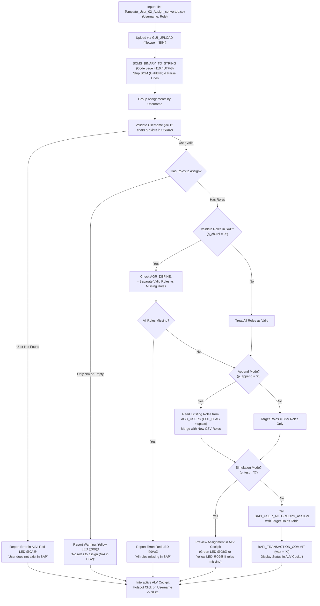

# 👥 Z_USER_02_ASSIGN_ROLE: Batch User Role Assignment Cockpit

> **SAP Basis Utilities & AI-Assisted ABAP Development via Model Context Protocol (MCP)**  
> **Source Code**: [`src/z_user_02_assign_role.prog.abap`](../src/z_user_02_assign_role.prog.abap)  
> **Companion Script**: [`scripts/convert_user_02_assign.py`](../scripts/convert_user_02_assign.py)  
> **CSV Template**: [`excel-templates/Template_User_02_Assign_converted.csv`](../excel-templates/Template_User_02_Assign_converted.csv)  
> **Conversion Guide**: [`docs/ROLE_CONVERSION_GUIDE.md`](ROLE_CONVERSION_GUIDE.md)  
> **Repository**: [https://github.com/luongdk18/SAPABAP](https://github.com/luongdk18/SAPABAP)

The ABAP utility **`Z_USER_02_ASSIGN_ROLE`** automates the mass assignment of SAP authorization roles (Single Roles, Derived Roles, and Composite Roles) to user master records directly from flat CSV data.

The program aggregates multiple role assignments per user, validates user existence in table `USR02`, verifies role existence in `AGR_DEFINE`, assigns roles atomically using standard SAP BAPI `BAPI_USER_ACTGROUPS_ASSIGN`, provides an **Append Mode (`p_append = 'X'`)** to safely preserve pre-existing user authorizations, supports date intervals, and reports results in an interactive ALV cockpit with **one-click navigation to transaction `SU01`**.

---

## 📌 Table of Contents
1. [Business Context & Problem Statement](#1-business-context--problem-statement)
2. [End-to-End Processing Workflow](#2-end-to-end-processing-workflow)
3. [Key Architectural & Functional Features](#3-key-architectural--functional-features)
   - [3.1. Aggregating Multi-Role Assignments Per User](#31-aggregating-multi-role-assignments-per-user)
   - [3.2. User & Role Repository Validation](#32-user--role-repository-validation)
   - [3.3. Safe Append Mode vs. Full Replace Mode](#33-safe-append-mode-vs-full-replace-mode)
   - [3.4. Graceful Handling of Empty Roles (`N/A`)](#34-graceful-handling-of-empty-roles-na)
   - [3.5. Direct Assignment Handling & Composite Role Expansion](#35-direct-assignment-handling--composite-role-expansion)
   - [3.6. Interactive ALV Cockpit with Direct SU01 Navigation](#36-interactive-alv-cockpit-with-direct-su01-navigation)
4. [Selection Screen & Operational Parameters](#4-selection-screen--operational-parameters)
5. [Standard SAP Function Modules & Database Tables](#5-standard-sap-function-modules--database-tables)
6. [Operational Step-by-Step Guide](#6-operational-step-by-step-guide)
7. [Troubleshooting & Frequently Asked Questions (FAQ)](#7-troubleshooting--frequently-asked-questions-faq)

---

## 1. Business Context & Problem Statement

During SAP rollouts, new go-lives, annual access reviews, or organizational restructurings, assigning authorizations to dozens or hundreds of business users is one of the most critical and time-sensitive operational tasks.

### Operational Bottlenecks in Standard User Maintenance:
1. **Manual Entry in `SU01`**: Security administrators must open each user individually, switch to the "Roles" tab, manually type role names, set valid from/to dates, and save.
2. **Accidental Role Loss**: Standard batch interfaces often overwrite existing user roles if not carefully configured, stripping access required for daily business tasks.
3. **Invalid Role Reference**: If a role was mistyped or has not yet been imported into the system, mass uploads may fail entirely or leave partial assignments.
4. **No Unified Execution Audit**: Standard tools lack a clear simulation and comparison cockpit displaying how many roles exist, which are missing, and which were assigned.

`Z_USER_02_ASSIGN_ROLE` eliminates these operational bottlenecks with an automated, safe, and verifiable assignment pipeline.

---

## 2. End-to-End Processing Workflow



---

## 3. Key Architectural & Functional Features

### 3.1. Aggregating Multi-Role Assignments Per User
The program reads normalized 2-column CSV lines (`Username, Role`) and aggregates all rows belonging to the same user into a unified target role assignment list:

```abap
TYPES: BEGIN OF ty_user_assignment,
         username TYPE bapibname-bapibname,
         has_na   TYPE abap_bool,
         roles    TYPE STANDARD TABLE OF agr_name WITH DEFAULT KEY,
       END OF ty_user_assignment.
```

### 3.2. User & Role Repository Validation
- **User Validation**: Validates each username against table `USR02`. If a user does not exist in SAP, processing for that user is safely halted and reported with a Red LED `@0A@`.
- **Role Validation (`p_chkrol = 'X'`)**: Checks each role name against table `AGR_DEFINE`. Any roles not found in SAP are isolated into the `MISSING_ROLES` column with a Warning status (`@09@`), while all valid roles continue to be assigned.

### 3.3. Safe Append Mode vs. Full Replace Mode
Standard SAP BAPI `BAPI_USER_ACTGROUPS_ASSIGN` replaces all roles for a user with the provided table. To prevent unintentional loss of access:
- **Append Mode (`p_append = 'X'`, Default)**: Queries `AGR_USERS` for currently assigned direct roles (`COL_FLAG = space`), merges them with the new roles from the CSV, and preserves pre-existing user authorizations.
- **Replace Mode (`p_append = ' '`)**: Replaces user roles entirely with the list from the CSV file.

### 3.4. Graceful Handling of Empty Roles (`N/A`)
If a user in the CSV has no assigned roles (marked as `N/A`), `Z_USER_02_ASSIGN_ROLE` handles the record gracefully without raising an error:
- Marked with a Yellow LED `@09@` (`WARNING`).
- Reported clearly as: *"No roles to assign for this user (marked as N/A in CSV)"*.

### 3.5. Direct Assignment Handling & Composite Role Expansion
When querying existing roles in Append Mode, the program filters on `COL_FLAG = space`. This ensures only **directly assigned roles** are passed to the BAPI. When a composite role is directly assigned, SAP automatically provisions and manages all underlying single roles.

### 3.6. Interactive ALV Cockpit with Direct SU01 Navigation
Output results are rendered with `CL_SALV_TABLE`. The **Username** column is configured as a clickable hotspot. Clicking on any username opens transaction `SU01` directly for immediate verification.

---

## 4. Selection Screen & Operational Parameters

```text
╔════════════════════════════════════════════════════════════════════════════╗
║ Selection Screen: Z_USER_02_ASSIGN_ROLE                                    ║
╠════════════════════════════════════════════════════════════════════════════╣
║ Input CSV File (.csv)                                                      ║
║   File Path:                  [                                    ] [F4]  ║
╠════════════════════════════════════════════════════════════════════════════╣
║ Execution & Assignment Options                                             ║
║   [X] Simulation (Test Run)                                                ║
║   [X] Append to Existing Roles                                             ║
║   [X] Validate Roles in SAP                                                ║
╠════════════════════════════════════════════════════════════════════════════╣
║ Assignment Validity Period                                                 ║
║   Valid From Date:            [21.10.2026]                                 ║
║   Valid To Date:              [31.12.9999]                                 ║
╚════════════════════════════════════════════════════════════════════════════╝
```

| Parameter | Type | Default | Description |
|---|---|---|---|
| `p_file` | `localfile` | Mandatory | Full path to the `.csv` file on the client machine. Supports F4 dialog. |
| `p_test` | `abap_bool` | `'X'` | Simulation mode. Validates and displays actions without committing changes. |
| `p_append` | `abap_bool` | `'X'` | Append to existing roles. If unchecked, replaces existing user roles. |
| `p_chkrol` | `abap_bool` | `'X'` | Validate role existence in `AGR_DEFINE` before attempting assignment. |
| `p_from` | `bapiagr-from_dat` | `sy-datum` | Validity start date for role assignments. |
| `p_to` | `bapiagr-to_dat` | `'99991231'` | Validity end date for role assignments. |

---

## 5. Standard SAP Function Modules & Database Tables

| Object Name | Type | Purpose |
|---|---|---|
| `BAPI_USER_ACTGROUPS_ASSIGN` | Function Module | Standard SAP BAPI to assign authorization roles to a user. |
| `BAPI_TRANSACTION_COMMIT` | Function Module | Synchronous commit (`WAIT = 'X'`) after role assignment. |
| `SCMS_BINARY_TO_STRING` | Function Module | Converts binary byte stream into Unicode string with UTF-8 (`4110`). |
| `USR02` | Database Table | Verifies user existence and logon status. |
| `AGR_DEFINE` | Database Table | Verifies role existence (Single, Derived, Composite). |
| `AGR_USERS` | Database Table | Reads existing user-role assignments (`COL_FLAG = space`). |
| `S_USER_AGR` | Authorization Object | Checked during `START-OF-SELECTION` for activity `22` (Assign) and `02` (Change). |

---

## 6. Operational Step-by-Step Guide

### Step 1: Prepare Excel Matrix & Convert to CSV
1. Maintain your user-role assignment matrix in Excel or use template [`Template_User_02_Assign.xlsx`](../excel-templates/Template_User_02_Assign.xlsx).
2. Run the conversion script:
   ```bash
   npm run convert:user:02
   # Outputs Template_User_02_Assign_converted.csv
   ```
3. The script extracts marked assignments (`Y`, `y`, `X`, `x`), formats `Username,Role`, and produces `Template_User_02_Assign_converted.csv`.

### Step 2: Deploy the ABAP Program (One-Time)
```bash
npm run deploy:user:02
```

### Step 3: Run Simulation in SAP GUI
1. Open transaction `SE38` or `SA38` and execute `Z_USER_02_ASSIGN_ROLE`.
2. Browse to select your `Template_User_02_Assign_converted.csv` file.
3. Keep **Simulation (Test Run)** checked (`p_test = 'X'`).
4. Click **Execute (`F8`)**.
5. Check the ALV report:
   - Green LED `@08@` (`SIMULATED`): All roles are valid and will be assigned.
   - Yellow LED `@09@` (`WARNING`): Some roles are missing in SAP or marked as `N/A`.
   - Red LED `@0A@` (`ERROR`): User does not exist in `USR02`.

### Step 4: Execute Live Role Assignment
1. Return to the selection screen (`F3`).
2. Uncheck **Simulation (Test Run)** (`p_test = ' '`).
3. Click **Execute (`F8`)**.
4. The ALV report displays Green LED `@08@` (`ASSIGNED`).
5. Click any **Username** cell to open transaction `SU01` and verify the assigned roles.

---

## 7. Troubleshooting & Frequently Asked Questions (FAQ)

### Q1: What happens if a user already has roles assigned in SAP?
If **Append to Existing Roles (`p_append = 'X'`)** is selected (default), the program reads the user's currently assigned direct roles from `AGR_USERS` and merges them with the new roles from the CSV file. If unchecked, the user's roles are replaced with only the roles specified in the CSV.

### Q2: What happens if a role does not exist in SAP?
When **Validate Roles in SAP (`p_chkrol = 'X'`)** is active, the program isolates missing roles into the `MISSING_ROLES` column and assigns all remaining valid roles. The row status is marked with a Yellow LED `@09@` (`WARNING`) so the administrator can investigate the missing role definitions.

### Q3: Can composite roles be assigned using this program?
Yes. Both composite roles and single roles can be assigned. When a composite role is assigned, SAP's standard profile generator and user comparison automatically provision all member single roles to the user.
